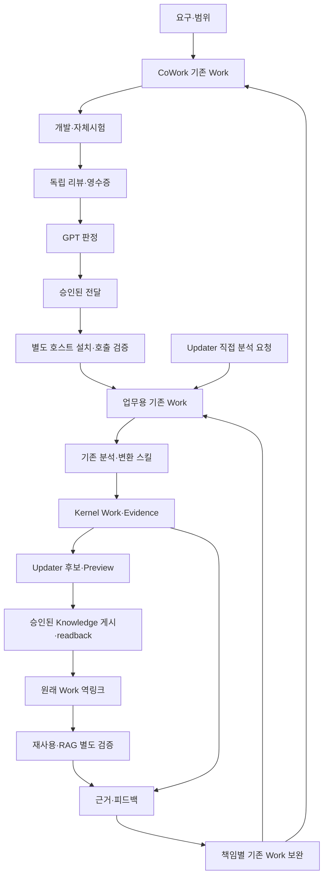

# CoWork 공통 맥락 브리프

- 개정: r0013 / 2026-11-21 KST CoWork PUBLIC 전환에 따른 저장소 역할 갱신. 이전 동작·리뷰·스킬 현황은 각 CURRENT에서 재확인.
- 저장소: **GitHub PUBLIC** `wonhwipark/CoWork-Skill-Collab`, branch `main` (2026-11-21 실제 visibility 조회). 기존 PRIVATE 경로·문구는 당시 이력. 회사 제한 자료·키/토큰의 신규 게시 허용이 아님.
- 역할: 협업·L1 지식·관리 스킬의 **고정 지도**. 진행 상태·최신 버전·리뷰 결과·승인 대기·source blob을 복사하지 않는다.
- 읽기: **이 지도 → 요청 목적에 맞는 CURRENT → 필요한 근거·계약·스킬 원문**. 현재 상태는 실행할 때 해당 정본을 조회한다.
- **세션 로딩:** Windows Claude Code는 CoWork 저장소에서 시작 시 루트 [`CLAUDE.md`](../CLAUDE.md)를 통해 `AGENTS.md`·이 브리프를 프로젝트 맥락으로 import할 수 있다. GPT는 CoWork 프로젝트 지침에 따른 요청 시 조회다. **Claude의 실제 호스트 로딩·GitHub 최신 정보 자동 조회 및 GPT의 무요청 선조회는 각각 별도 검증/제약**으로 구분한다.
- **GPT 공통 투두:** [전체 개선 후보·GPT 검토 의견](GPT_TODO.md). 후보 조회·정리·작업 연결은 이 목록에서 관리하고, 실행 진행은 관련 CURRENT에서 확인한다.

- **P1/P2 빠른 맥락 조회:** [단계별 질문 조회·근거/시점·관계/변경분 안내](projects/COWORK-SKILL-DISCOVERY-20261112-001/P1_P2_CONTEXT_APPLICATION_GUIDE_r0001_20261120_KST.md). 대화에서는 관련 CURRENT+증거를 직접 조회하고, PRIVATE 로컬 체크아웃에서는 선택적 읽기 전용 `collab/dashboard/context_query.py`를 사용할 수 있다. PUBLIC 요약은 기존 B안 Pages의 허용목록만 이용하며 호스트 LIVE/실행 사실을 자동 검증하지 않는다.

- **L1Work 스킬 현황 바로가기:** [공개 ZIP·관리 스킬 분석 인덱스](projects/COWORK-SKILL-DISCOVERY-20261112-001/L1WORK_PUBLIC_SKILL_RELEASE_ANALYSIS_r0001_20261117_KST.md) · [스킬 관리 CURRENT](projects/COWORK-SKILL-DISCOVERY-20261112-001/CURRENT.md). 공개본/개발 후보/검증 경계를 구분해 확인하고, 최신 버전·판정은 실제 PUBLIC HEAD와 관련 Work CURRENT에서 재조회한다.
- 갱신 기준: [스킬 발견·재사용 절차](ops/CONTRACTS/SKILL_DISCOVERY_AND_REUSE_V1.md). 결과·피드백은 해당 Work에서 관리하고 지도는 구조·역할·경로가 바뀔 때만 수정한다.

## 자연어 “정식 리뷰 요청” — 새 창 기본 진입

리뷰 요청은 단순 문서 게시가 아니다. 새 창의 GPT/Windows Claude Code는 사용자 자연어 **“정식 리뷰 요청해 줘”**를 받으면 기존 Work·기존 요청/영수증/승인을 확인한 다음 [표준 REQUEST/PIN 게시·차단 계약](ops/CONTRACTS/PRE_READY_SOURCE_PIN_PREFLIGHT_V1.md)으로 이동한다. 구현: `collab/ops/submit_review_request.py`(게시 전 정책+ZIP 검사, Commit A REQUEST+ZIP, Commit B PIN, 원격 검증), `collab/ops/review_pin_preflight.py`(읽기 전용 PIN 검사). 전용 명령 미사용·호스트 정책 미확인이면 정식 리뷰 접수/실행 완료로 보고하지 않는다. **서명·READY·Claude 결과/영수증은 별도 확인**. 문서 연결만으로 모든 새 창에서 자동 실행되거나 Windows 운영 hook이 설치된 것은 아니다.

## 0. 협업 → 업무·지식 → 피드백 전체 흐름

[통합 탑뷰·정본 책임·인계 계약](projects/COWORK-SKILL-DISCOVERY-20261112-001/COWORK_L1_INTEGRATED_TOPVIEW_r0001_20261115_KST.md)에서 단계·입력·승인·검증 경계를 확인한다. 아래 화살표는 **책임/전달 관계**이며 실제 자동 호출·설치·호스트 접속이 검증됐다는 뜻이 아니다.

CoWork Work/리뷰 요청과 업무 Kernel Work는 별개다. 팀 지식 정본은 검증된 상세 설계·HLD·AS-IS MSC를 포함할 수 있고, 업무 Workspace는 Updater 직접 분석과 Workflow 업무 분석 모두의 초안·분석/결정/Evidence 원본을 보존한다. 그룹 공용 `l1sw-dev-knowledge`의 반영 여부와 개인 Work 보존을 분리한다. 협업 운송 LIVE와 자동 승인 개선 상태는 각각 아래 해당 CURRENT에서 **별도로** 확인한다. 원본·승인·실행·게시·RAG 성공을 한 단계로 묶지 않는다.

## 1. 역할과 정본

| 대상 | 책임·정본 |
|---|---|
| 설계 GPT | 허용된 문서·비민감 상태로 설계·정합성·리뷰 결과를 판정하고 정본 연결 관리 |
| 업무 GPT | 실행 LLM/Agent 결과를 전달받아 분석·판정하고 업무 지침·Work·지식 후보 연결 관리 |
| 실행 LLM·Agent | 허용된 도구·스킬로 실제 작업, Evidence 보고, 해당 결과·CURRENT 게시와 원격 확인 |
| Windows Claude Code | 기본 독립 리뷰어. 로컬 구현 세션의 자체시험과 별도 독립 리뷰를 구분 |
| Python watcher | 승인된 REQUEST/READY·정책·서명·비용·중복 검증 뒤 리뷰 운송·실행·영수증 관리 |
| CoWork PUBLIC | 공개 가능한 협업 설계·결정·결과·리뷰·영수증. 현재 상태는 프로젝트 CURRENT. 비밀·업무 제한 자료는 게시 금지 |
| L1Work PUBLIC | 별도 승인된 최종 ZIP(main 루트), 인계(handoffs), 허용목록 상태 화면 |
| 업무용 l1-workspace | Work ID·진행·분석/결정·수정/시험/리뷰·Evidence 원본. 동명 GitHub.com 저장소로 추정 금지 |
| 그룹 공용 l1sw-dev-knowledge | 팀 공용 스킬과 관리하는 검증 기술 지식. 실제 저장 위치는 설치 계약으로 확인; 게시 결과와 Work 역링크는 각각 확인 |

사용자 최신 지시와 최신 실제 근거가 우선한다. 민감 코드·상세 MSC/로그·고객자료·비밀은 PRIVATE에도 게시하지 않는다. [운영 계약](START_HERE.md) · [역할·용어](ops/CONTRACTS/EXECUTION_PROMPT_TERMINOLOGY_V1.md).

## 2. L1 지식·스킬 연결 원칙

- 기존 Workflow/Kernel/Updater/analyzer/converter/Git·P4의 **REUSE → CONNECT → 입증된 GAP만 최소 EXTEND**. 미확인을 기능 부재로 단정하지 않는다.
- Workflow는 요청·Work 선택/재개, Kernel은 Work/Evidence, code-analyzer는 코드 사실, doc-converter는 문서·MSC 표현, Knowledge Updater는 후보·중복/충돌·Preview·승인/기존 writer 연결을 담당하는 설계다. 실제 지원·설치·호출은 관련 CURRENT와 원문으로 확인한다.
- 기술 정본의 Module → Feature → Scenario 구조, Procedure/운용 맥락의 교차 탐색, AS-IS/TO-BE 구분을 유지한다. 검토행을 실제 Feature/Scenario ID·코드 지원 승인으로 취급하지 않는다.
- 개인 Work의 분석·결정·Evidence 이력을 보존하고 검증된 기술 지식을 그룹 정본 revision에 연결한다. 상세도만으로 개인/그룹을 결정하지 않는다.
- 두 진입(Updater의 Procedure/Feature 직접 분석 / Workflow 업무 결과 지식화) → 개인 `l1-workspace`의 같은 Work에 분석·초안·근거 보존 → 후보/대조/Preview → 보완 또는 승인된 그룹 반영 → readback·원래 Work 결과 회수: [Workspace 보존·그룹 반영 설계](projects/L1-WORKSPACE-RAG-20261111-001/L1_WORK_TO_KNOWLEDGE_FLOW_r0002_20261115_KST.md). 그룹 미반영에도 개인 분석 이력은 보존. 구현·호출·검증은 L1 CURRENT에서 확인.
- 최초 실제 분석 후 확인하기로 한 항목은 해당 Work의 후속 검증으로 관리한다. 미실행을 확인된 결함이나 완료 근거로 바꾸지 않는다.

| 요청 기능 | 우선 검토할 기존 스킬 |
|---|---|
| Work·연속성 | l1-fix-workflow, work-ledger-kernel |
| 로그·코드 분석/수정 | issue-analyzer, code-analyzer, code-fix |
| HLD·MSC·설계/구현 비교 | hld-composer, doc-converter, hld-code-compare, hld-code-implement |
| Git/P4 근거·충돌 처리 | l1-github, p4-code-owner, l1-cl2git-merge |
| LOC/MCD | l1-sam-fixer |
| 설치·실행 게이트·Job·예약·정리 | skill-updater, skillsilent, job-list, autotask-builder, l1-cleanup |
| 지식 후보·게시 연결 | l1-knowledge-updater |

[카탈로그](knowledge/SKILL_CAPABILITY_CATALOG.md)는 책임·입출력·연결을 안내한다. 최신 버전/설치/시험 상태는 해당 CURRENT와 실제 스킬 원문, 과거 패키지 감사는 그 시점의 근거로 확인한다.

모바일 Agent → Linux MCP → 기존 Work 검색/재개 또는 승인된 Job/Runner → 결과·영수증 조회 → 업무 GPT 판정 → Work/Evidence → 필요한 지식 후보화 순서로 연결한다. 정확한 도구·호출 계약은 확인하며 패키지 설치·Job 실행·결과 조회·지식 게시를 별도로 판정한다.

## 3. 요청별 진입 경로

아래는 **목적별 경로**이며 진행 상태표가 아니다. 같은 Work 안의 설계·구현·회귀시험·독립 리뷰를 구분하고, 같은 목적의 피드백은 기존 Work를 이어간다.

| 요청 목적 | 먼저 읽을 CURRENT |
|---|---|
| 협업 provider·독립 리뷰 운송·LIVE/롤백 | [이관](projects/COWORK-DROPBOX-TO-GITHUB-MIGRATION/CURRENT.md) |
| 자동 승인·서명 개선 | [자동 승인](projects/COWORK-AUTO-APPROVAL-20261115-001/CURRENT.md) |
| L1 지식·RAG·Workflow/Updater·CL/PR 설계 | [L1 지식](projects/L1-WORKSPACE-RAG-20261111-001/CURRENT.md) |
| 담당 모듈·Procedure/Feature·분류 검토 | [담당 범위](projects/L1-CHANNEL-KNOWLEDGE-SCOPE-20261113-001/CURRENT.md) |
| NR L1 Tx 실제 코드 분석·해당 Job | [NR 코드 분석](projects/NR-L1TX-CODE-ANALYSIS-20261115-001/CURRENT.md) |
| 기존 Job-list Registry·MCP 결과 조회 장애 | [기존 Job 진단](projects/JOBLIST-NRTX-20261112-001/CURRENT.md) |
| 모델 호출 없는 Job 운송·Worker 도달 검증 | [Smoke](projects/JOBLIST-SMOKE-20261114-001/CURRENT.md) |
| 대시보드 화면·가독성·공개 상태 표시 | [대시보드](projects/COWORK-GITHUB-DASHBOARD-20261111-001/CURRENT.md) |
| Issue Analyzer 변경·전달 | [Issue Analyzer](projects/ISSUE-ANALYZER-20261114-001/CURRENT.md) |
| 새 창 재개·관리 스킬 발견·이 지도 | [맥락 운용](projects/COWORK-SKILL-DISCOVERY-20261112-001/CURRENT.md) |

새 Work가 필요하면 같은 목적의 기존 Work부터 찾고 기존 등록 계약으로 등록한다. 신규·변경된 작업의 진입 경로만 이 지도에 추가한다. Job 관련이라는 이유로 실제 분석·진단·Smoke를 같은 작업으로 합치지 않는다.

## 4. 작업·피드백·다음 창 재개

**동일 산출물의 병렬 대화창/Agent 개발은 [통합 게이트 계약](ops/CONTRACTS/PARALLEL_CHANGE_INTEGRATION_GATE_V1.md)을 적용한다.** 다른 창의 원본 revision·stream 등록/최종 단일 ZIP·회귀/교차 시험을 확인하고, 미통합은 최종 완료/운영 배포 보류. 독립 검사기 및 실제 게시 경로 연결 여부는 관련 Work CURRENT에서 확인.

1. 지도에서 관련 Work를 고르고 해당 CURRENT와 필요한 최신 결과·열린 메모를 조회한다.
2. 대상·작업 흐름·고정 입력 revision·완료 근거·미확인·기존 승인 범위·다음 한 행동/담당을 확인한다. 이 항목은 문서상 최소 인계 내용이며 새 Kernel 필드가 아니다.
3. 허용된 스킬로 작업하고 결과를 기록한다. 피드백을 수용/수정 수용/거절/보류/추가 확인으로 판정하고 필요한 보완은 같은 Work에서 진행한다.
4. 결과·판정 원문은 기존 결과/결정/notes에 보존하고 해당 CURRENT의 짧은 현재 요약·근거 링크·미해결·다음 행동을 갱신한다. 기존 TRACKER는 필요한 현행 추적 필드만 맞춘다.
5. 작업한 GPT/Agent가 PRIVATE 게시 후 commit·원격 본문·바이트 해시를 확인한다. 게시/조회 실패는 NOT_POSTED/UNVERIFIED로 남기며 게시 실패 때문에 분석·리뷰·Job을 재실행하지 않는다.
6. 다음 창은 다시 관련 CURRENT와 새 근거를 읽고 이어간다. 최신 조회 불가 시 마지막 확인 시점과 미확인을 밝히고 과거 상태로 실행 가능 여부를 확정하지 않는다.

문서 연결은 이를 읽는 세션에 적용한다. ChatGPT 프로젝트 설정·새 창 자동 선조회·대화 자동 저장·스킬 설치·예약 작업·모델 호출을 이 지도 게시로 설정하지 않는다. 운영 변경·PUBLIC 게시·유료 리뷰는 해당 계약과 실제 승인 범위를 따른다.
