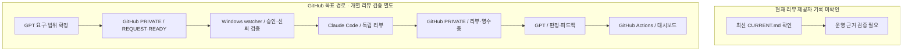

# CoWork GitHub SHADOW 대시보드

> **MIGRATION_NOT_CUTOVER** — 활성 리뷰 제공자 기록 미확인. GitHub 기록과 리뷰 실행은 별개입니다.

이 문서는 GitHub Actions가 생성하는 안내 화면이며 리뷰·설치·배포 승인이나 자동 실행 결과가 아닙니다.

- 문서가 있는 프로젝트: **10개**
- GitHub REQUEST 파일 관측: **10개** (검증 안 됨)
- GitHub REVIEW 파일 관측: **6개** (검증 안 됨)
- GitHub RECEIPT 파일 관측: **6개** (검증 안 됨)

## 협업 흐름과 상태 · 역할 기준

**협업 관리 환경** — GPT · GitHub / **업무 실행 환경** — Windows 감시기 · Claude Code

> 화살표는 설계된 경로입니다. Windows 실행·서명 검증·독립 리뷰의 PASS를 뜻하지 않습니다.

### 운영·검증 상태

| 구분 | 현재 상태 | 근거 범위 |
|---|---|---|
| 현재 운영 경로 | **활성 리뷰 제공자 기록 미확인** | 최신 이관 CURRENT 기록 · 실제 호스트는 별도 검증 |
| GitHub 전환 | **기록 미관측** | 호스트 보고·GPT 판정과 신규 요청 실전 검증은 별개 |
| Windows 실행·SHADOW | **기록 미관측** | 실제 호스트 실행 증거 필요 |
| Claude Code 독립 리뷰 | **기록 미관측** | 자체 시험과 구분 |
| GitHub 요청·결과·영수증 | **요청 10 · 결과 6 · 영수증 6** | PRIVATE 파일 관측 수일 뿐 완료 건수가 아님 |
| 공개 Work 대시보드 | **기록 미관측** | L1Work에 승인된 비식별 상태만 자동 요약 · PRIVATE 원문은 비공개 |

[전환·Windows 원문](../projects/COWORK-DROPBOX-TO-GITHUB-MIGRATION/CURRENT.md) · [대시보드 원문](../projects/COWORK-GITHUB-DASHBOARD-20261111-001/CURRENT.md)

## 작업별 진행 현황 · 독립 Work Tracker

각 Work는 고유 ID로 구분. 단계/시험/리뷰 표시는 문서 신고값이며 실제 완료 검증이 아닙니다.

| Work ID | 스킬 | 진행 단계(신고) | 담당 | 시험(신고) | 독립 리뷰(신고) | 다음 조치 |
|---|---|---|---|---|---|---|
| [COWORK-AUTO-APPROVAL-20261115-001](https://github.com/wonhwipark/CoWork-Skill-Collab/blob/main/collab/projects/COWORK-AUTO-APPROVAL-20261115-001/CURRENT.md) | cowork-review-watcher | 완료 신고 (검증 필요) | Windows 운영 호스트 (자동 승인 LIVE) / GPT 판정 | PASS | PASS | 2026-11-16 19:47 KST: v0.2.23 운영 설치·보호 위임 활성화 완료(AUTO_SIGNING_LIVE=PASS_HOST_VERIFIED). 전 게이트 PASS, 회귀 967 passed/12 skipped, 2주기·재시작·소급 3건 차단·Notifier·롤백 준비 확인, 모델  |
| [COWORK-DROPBOX-TO-GITHUB-MIGRATION](https://github.com/wonhwipark/CoWork-Skill-Collab/blob/main/collab/projects/COWORK-DROPBOX-TO-GITHUB-MIGRATION/CURRENT.md) | cowork-review-watcher | 완료 신고 (검증 필요) | GPT / Claude Code | PASS | PASS | 기존 GitHub LIVE 유지. 새 완료 리뷰 Actions 감지 PASS(77+8 시험), 기존 Telegram 연동 USER_CONFIRMED. Claude 리뷰 원문→GPT 직접 GitHub 수신 8항목 PASS, 기존 판정 1사이클 종료. GitHub push→유휴 GPT 자동수신 NO |
| [COWORK-GITHUB-DASHBOARD-20261111-001](https://github.com/wonhwipark/CoWork-Skill-Collab/blob/main/collab/projects/COWORK-GITHUB-DASHBOARD-20261111-001/CURRENT.md) | cowork-dashboard | 독립 리뷰 | GPT | PASS | PENDING | 대시보드의 두 진입·개인/그룹 구분을 확인. 실제 Updater→Workspace 저장 연결은 L1 Work에서 업무 GPT의 설치본 매핑으로 확인. |
| [COWORK-SKILL-DISCOVERY-20261112-001](https://github.com/wonhwipark/CoWork-Skill-Collab/blob/main/collab/projects/COWORK-SKILL-DISCOVERY-20261112-001/CURRENT.md) | skill-discovery | GPT 판정 | GPT | PASS | NOT_RUN | TD-002 V07 PASS·TD-001 탑뷰 문서 완료; TD-003 실제 E2E는 NR 분석 기존 Work의 Linux 설치 SHA·신규 Job/Receipt/MCP readback 증거 확보 후 재판정 |
| [ISSUE-ANALYZER-20261114-001](https://github.com/wonhwipark/CoWork-Skill-Collab/blob/main/collab/projects/ISSUE-ANALYZER-20261114-001/CURRENT.md) | issue-analyzer | 차단·보류 | GPT | NOT_VERIFIED | NOT_RUN | 전체 회귀·독립 리뷰 후 L1Work PUBLIC 루트에 ZIP 게시 및 SHA 원격 재검증 |
| [JOBLIST-NRTX-20261112-001](https://github.com/wonhwipark/CoWork-Skill-Collab/blob/main/collab/projects/JOBLIST-NRTX-20261112-001/CURRENT.md) | job-list | 개발·시험 | GPT | PASS | NOT_RUN | 호스트 G0 확인 전 후보 패키지 검증 범위 유지 |
| [JOBLIST-SMOKE-20261114-001](https://github.com/wonhwipark/CoWork-Skill-Collab/blob/main/collab/projects/JOBLIST-SMOKE-20261114-001/CURRENT.md) | 미지정 | 단계 미확인 | 미등록 | NOT_VERIFIED | NOT_VERIFIED | CURRENT.md 최신 상태 및 다음 담당 확인 |
| [L1-CHANNEL-KNOWLEDGE-SCOPE-20261113-001](https://github.com/wonhwipark/CoWork-Skill-Collab/blob/main/collab/projects/L1-CHANNEL-KNOWLEDGE-SCOPE-20261113-001/CURRENT.md) | l1-knowledge-updater | 독립 리뷰 | GPT | PASS | NOT_RUN | v0.9 215행 담당자 검토; 실제 ID·산출물 검증은 첫 승인된 분석 후속 |
| [L1-WORKSPACE-RAG-20261111-001](https://github.com/wonhwipark/CoWork-Skill-Collab/blob/main/collab/projects/L1-WORKSPACE-RAG-20261111-001/CURRENT.md) | 미지정 | 단계 미확인 | 미등록 | NOT_VERIFIED | NOT_VERIFIED | CURRENT.md 최신 상태 및 다음 담당 확인 |
| [NR-L1TX-CODE-ANALYSIS-20261115-001](https://github.com/wonhwipark/CoWork-Skill-Collab/blob/main/collab/projects/NR-L1TX-CODE-ANALYSIS-20261115-001/CURRENT.md) | 미지정 | 단계 미확인 | 미등록 | NOT_VERIFIED | NOT_VERIFIED | CURRENT.md 최신 상태 및 다음 담당 확인 |

스킬별 병렬 작업은 각 프로젝트의 TRACKER.json으로 등록합니다. 등록 전에는 확인되지 않은 실제 진행률을 추정하지 않습니다.

### 프로젝트별 상태 원문

| 프로젝트 | 문서상 상태 | 근거 |
|---|---|---|
| COWORK-AUTO-APPROVAL-20261115-001 | 문서상 진행 | [CURRENT.md](https://github.com/wonhwipark/CoWork-Skill-Collab/blob/main/collab/projects/COWORK-AUTO-APPROVAL-20261115-001/CURRENT.md) |
| COWORK-DROPBOX-TO-GITHUB-MIGRATION | 문서상 진행 | [CURRENT.md](https://github.com/wonhwipark/CoWork-Skill-Collab/blob/main/collab/projects/COWORK-DROPBOX-TO-GITHUB-MIGRATION/CURRENT.md) |
| COWORK-GITHUB-DASHBOARD-20261111-001 | 검증 진행 중 | [CURRENT.md](https://github.com/wonhwipark/CoWork-Skill-Collab/blob/main/collab/projects/COWORK-GITHUB-DASHBOARD-20261111-001/CURRENT.md) |
| COWORK-SKILL-DISCOVERY-20261112-001 | 문서상 진행 | [CURRENT.md](https://github.com/wonhwipark/CoWork-Skill-Collab/blob/main/collab/projects/COWORK-SKILL-DISCOVERY-20261112-001/CURRENT.md) |
| ISSUE-ANALYZER-20261114-001 | 상태 확인 필요 | [CURRENT.md](https://github.com/wonhwipark/CoWork-Skill-Collab/blob/main/collab/projects/ISSUE-ANALYZER-20261114-001/CURRENT.md) |
| JOBLIST-NRTX-20261112-001 | 문서상 진행 | [CURRENT.md](https://github.com/wonhwipark/CoWork-Skill-Collab/blob/main/collab/projects/JOBLIST-NRTX-20261112-001/CURRENT.md) |
| JOBLIST-SMOKE-20261114-001 | 상태 확인 필요 | [CURRENT.md](https://github.com/wonhwipark/CoWork-Skill-Collab/blob/main/collab/projects/JOBLIST-SMOKE-20261114-001/CURRENT.md) |
| L1-CHANNEL-KNOWLEDGE-SCOPE-20261113-001 | 상태 확인 필요 | [CURRENT.md](https://github.com/wonhwipark/CoWork-Skill-Collab/blob/main/collab/projects/L1-CHANNEL-KNOWLEDGE-SCOPE-20261113-001/CURRENT.md) |
| L1-WORKSPACE-RAG-20261111-001 | 검증 진행 중 | [CURRENT.md](https://github.com/wonhwipark/CoWork-Skill-Collab/blob/main/collab/projects/L1-WORKSPACE-RAG-20261111-001/CURRENT.md) |
| NR-L1TX-CODE-ANALYSIS-20261115-001 | 검증 진행 중 | [CURRENT.md](https://github.com/wonhwipark/CoWork-Skill-Collab/blob/main/collab/projects/NR-L1TX-CODE-ANALYSIS-20261115-001/CURRENT.md) |

미이관 파일이나 승인·서명 검증 결과가 없어도, 이 화면은 이를 임의로 성공/0건 완료 처리하지 않습니다.

## GitHub 리뷰·GPT 판정 연결

문서 연결은 승인 서명·운영 실행 검증이 아닙니다.

| 요청 | Work | 단계 | GPT 판정 |
|---|---|---|---|
| [REQ-COWORK-AUTO-APPROVAL-V023-R2-20261115](https://github.com/wonhwipark/CoWork-Skill-Collab/blob/main/collab/requests/REQ-COWORK-AUTO-APPROVAL-V023-R2-20261115/REQUEST.md) | COWORK-AUTO-APPROVAL-20261115-001 | GPT_NOT_OBSERVED | NOT_VERIFIED |
| [REQ-COWORK-DASHBOARD-PRESENTATION-20261115-001](https://github.com/wonhwipark/CoWork-Skill-Collab/blob/main/collab/requests/REQ-COWORK-DASHBOARD-PRESENTATION-20261115-001/REQUEST.md) | COWORK-GITHUB-DASHBOARD-20261111-001 | READY_NOT_OBSERVED | NOT_VERIFIED |
| [REQ-COWORK-V0214-R1-20261114](https://github.com/wonhwipark/CoWork-Skill-Collab/blob/main/collab/requests/REQ-COWORK-V0214-R1-20261114/REQUEST.md) | COWORK-DROPBOX-TO-GITHUB-MIGRATION | GPT_NOT_OBSERVED | NOT_VERIFIED |
| [REQ-COWORK-V0217-R2-20261114](https://github.com/wonhwipark/CoWork-Skill-Collab/blob/main/collab/requests/REQ-COWORK-V0217-R2-20261114/REQUEST.md) | COWORK-DROPBOX-TO-GITHUB-MIGRATION | GPT_NOT_OBSERVED | NOT_VERIFIED |
| ↳ N1 | — Approval nonce has no replay store (relevant to Q7)** | NOT_ADJUDICATED | - |
| ↳ N2 | — `repo_id` is a config-supplied label, not a GitHub-verified identity (Q7, confirms known gap)** | NOT_ADJUDICATED | - |
| ↳ N3 | — `read_github_token`'s repo-match check is advisory, not authorization (Q7, cli.py:33-55)** | NOT_ADJUDICATED | - |
| [REQ-COWORK-V0219-R2-20261114](https://github.com/wonhwipark/CoWork-Skill-Collab/blob/main/collab/requests/REQ-COWORK-V0219-R2-20261114/REQUEST.md) | COWORK-DROPBOX-TO-GITHUB-MIGRATION | GPT_NOT_OBSERVED | NOT_VERIFIED |
| ↳ Q1 | — Atomicity of the reservation | NOT_ADJUDICATED | - |
| ↳ Q2 | — Duplicate keys / binding | NOT_ADJUDICATED | - |
| ↳ Q3 | — Classification / double start / permanent refusal | NOT_ADJUDICATED | - |
| ↳ Q4 | — Crash / restore | NOT_ADJUDICATED | - |
| ↳ Q5 | — Remote errors / fail-closed | NOT_ADJUDICATED | - |
| ↳ Q6 | — N2 repository-id binding — **BLOCKING finding** | NOT_ADJUDICATED | - |
| ↳ Q7 | — Cost/gates, reservation vs. ceilings, SHADOW | NOT_ADJUDICATED | - |
| ↳ Q8 | — Interaction with v0.2.18, locking, seal_interrupted, publish-only retry | NOT_ADJUDICATED | - |
| [REQ-COWORK-V0220-R1-20261115](https://github.com/wonhwipark/CoWork-Skill-Collab/blob/main/collab/requests/REQ-COWORK-V0220-R1-20261115/REQUEST.md) | COWORK-DROPBOX-TO-GITHUB-MIGRATION | GPT_NOT_OBSERVED | NOT_VERIFIED |
| [REQ-L1-MSC-MD-LINK-STRUCTURE-20261115-001](https://github.com/wonhwipark/CoWork-Skill-Collab/blob/main/collab/requests/REQ-L1-MSC-MD-LINK-STRUCTURE-20261115-001/REQUEST.md) | L1-WORKSPACE-RAG-20261111-001 | READY_NOT_OBSERVED | NOT_VERIFIED |
| [REQ-L1-WORK-KNOWLEDGE-DESIGN-20261115-001](https://github.com/wonhwipark/CoWork-Skill-Collab/blob/main/collab/requests/REQ-L1-WORK-KNOWLEDGE-DESIGN-20261115-001/REQUEST.md) | L1-WORKSPACE-RAG-20261111-001 | READY_NOT_OBSERVED | NOT_VERIFIED |
| [REQ-L1-WORK-KNOWLEDGE-FIXED-R1-20261116](https://github.com/wonhwipark/CoWork-Skill-Collab/blob/main/collab/requests/REQ-L1-WORK-KNOWLEDGE-FIXED-R1-20261116/REQUEST.md) | L1-WORKSPACE-RAG-20261111-001 | GPT_RECORDED_UNAUTHENTICATED | ACCEPT_WITH_CHANGE |
| ↳ B-1 | Work 역링크 계약 모순 수용; 개인 Knowledge origin 우선 | ACCEPT | - |
| ↳ M-1 | Workflow 쓰기 방지는 검증된 실제 경계 필요 | ACCEPT | - |
| ↳ M-2 | 공통 Git writer 경합 직렬화 및 CAS | ACCEPT | - |
| ↳ M-3 | 그룹 구조 변경은 충돌·보류 후 재승인 | ACCEPT | - |
| ↳ M-4 | Exporter 보존 회귀 T01/T02 필수 | ACCEPT | - |
| ↳ m-1 | 전체 commit SHA와 파일별 revision 단위 명시 | ACCEPT | - |
| ↳ m-2 | 개인 복구 최대 3회, 그룹 재게시 0 | ACCEPT | - |
| [REQ-L1-WORK-KNOWLEDGE-GUARD-CODE-R1-20261117](https://github.com/wonhwipark/CoWork-Skill-Collab/blob/main/collab/requests/REQ-L1-WORK-KNOWLEDGE-GUARD-CODE-R1-20261117/REQUEST.md) | L1-WORKSPACE-RAG-20261111-001 | READY_NOT_OBSERVED | NOT_VERIFIED |

비차단 지적도 GPT 판정 기록 전에는 해결 처리하지 않습니다.
