# CoWork GitHub SHADOW 대시보드

> **MIGRATION_NOT_CUTOVER** — 활성 리뷰 제공자 없음. GitHub 기록과 리뷰 실행은 별개입니다.

이 문서는 GitHub Actions가 생성하는 안내 화면이며 리뷰·설치·배포 승인이나 자동 실행 결과가 아닙니다.

- 문서가 있는 프로젝트: **7개**
- GitHub REQUEST 파일 관측: **0개** (검증 안 됨)
- GitHub REVIEW 파일 관측: **0개** (검증 안 됨)
- GitHub RECEIPT 파일 관측: **0개** (검증 안 됨)

## 협업 흐름과 상태 · 역할 기준

**협업 관리 환경** — GPT · GitHub / **업무 실행 환경** — Windows 감시기 · Claude Code

```mermaid
flowchart TB
  subgraph LIVE["현재 상태 · 활성 리뷰 제공자 없음"]
    L1["GPT 작업·판정"] --> L2["GitHub PRIVATE 상태 기록"]
    L2 --> L3["공개 허용 상태 검증"]
    L3 --> L4["L1Work Pages 업무 현황"]
  end
  subgraph NEXT["GitHub 목표 경로 · 정식 전환 전"]
    A["GPT 요구·범위 확정"] --> B["GitHub PRIVATE / REQUEST·READY"]
    B --> C["Windows watcher / 승인·신뢰 검증"]
    C --> D["Claude Code / 독립 리뷰"]
    D --> E["GitHub PRIVATE / 리뷰·영수증"]
    E --> F["GPT / 판정·피드백"]
    F --> G["GitHub Actions / 대시보드"]
  end
  %% 독립 리뷰 운송은 별도 유효 요청과 LIVE 승인 이후에만 실행
```

> 화살표는 설계된 경로입니다. Windows 실행·서명 검증·독립 리뷰의 PASS를 뜻하지 않습니다.

### 운영·검증 상태

| 구분 | 현재 상태 | 근거 범위 |
|---|---|---|
| 현재 운영 경로 | **활성 리뷰 제공자 없음** | 최신 이관 CURRENT 기록 · 실제 호스트는 별도 검증 |
| GitHub 전환 | **정식 전환 전** | 별도 명시적 승인 전 전환 금지 |
| Windows 실행·SHADOW | **기록 미관측** | 실제 호스트 실행 증거 필요 |
| Claude Code 독립 리뷰 | **원문 확인 필요** | 자체 시험과 구분 |
| GitHub 요청·결과·영수증 | **요청 0 · 결과 0 · 영수증 0** | PRIVATE 파일 관측 수일 뿐 완료 건수가 아님 |
| 공개 Work 대시보드 | **기록 미관측** | L1Work에 승인된 비식별 상태만 자동 요약 · PRIVATE 원문은 비공개 |

[전환·Windows 원문](../projects/COWORK-DROPBOX-TO-GITHUB-MIGRATION/CURRENT.md) · [대시보드 원문](../projects/COWORK-GITHUB-DASHBOARD-20261111-001/CURRENT.md)

## 작업별 진행 현황 · 독립 Work Tracker

각 Work는 고유 ID로 구분. 단계/시험/리뷰 표시는 문서 신고값이며 실제 완료 검증이 아닙니다.

| Work ID | 스킬 | 진행 단계(신고) | 담당 | 시험(신고) | 독립 리뷰(신고) | 다음 조치 |
|---|---|---|---|---|---|---|
| [COWORK-DROPBOX-TO-GITHUB-MIGRATION](https://github.com/wonhwipark/CoWork-Skill-Collab/blob/main/collab/projects/COWORK-DROPBOX-TO-GITHUB-MIGRATION/CURRENT.md) | 미지정 | 단계 미확인 | 미등록 | NOT_VERIFIED | NOT_VERIFIED | CURRENT.md 최신 상태 및 다음 담당 확인 |
| [COWORK-GITHUB-DASHBOARD-20261111-001](https://github.com/wonhwipark/CoWork-Skill-Collab/blob/main/collab/projects/COWORK-GITHUB-DASHBOARD-20261111-001/CURRENT.md) | cowork-dashboard | GPT 판정 | GPT | PASS | NOT_RUN | PUBLIC 자동 동기화 E2E 검증 완료 후 GPT 최종 판정 및 HTML 사용성 확인; 독립 리뷰 미실행 유지 |
| [COWORK-SKILL-DISCOVERY-20261112-001](https://github.com/wonhwipark/CoWork-Skill-Collab/blob/main/collab/projects/COWORK-SKILL-DISCOVERY-20261112-001/CURRENT.md) | skill-discovery | GPT 판정 | GPT | NOT_VERIFIED | NOT_RUN | 통합 브리프→관련 CURRENT 진입 문서 적용; 실제 새 창 사용 후 관련 요약·출처만 유지보수 |
| [ISSUE-ANALYZER-20261114-001](https://github.com/wonhwipark/CoWork-Skill-Collab/blob/main/collab/projects/ISSUE-ANALYZER-20261114-001/CURRENT.md) | issue-analyzer | 차단·보류 | GPT | NOT_VERIFIED | NOT_RUN | 전체 회귀·독립 리뷰 후 L1Work PUBLIC 루트에 ZIP 게시 및 SHA 원격 재검증 |
| [JOBLIST-NRTX-20261112-001](https://github.com/wonhwipark/CoWork-Skill-Collab/blob/main/collab/projects/JOBLIST-NRTX-20261112-001/CURRENT.md) | job-list | 개발·시험 | GPT | PASS | NOT_RUN | 호스트 G0 확인 전 후보 패키지 검증 범위 유지 |
| [L1-CHANNEL-KNOWLEDGE-SCOPE-20261113-001](https://github.com/wonhwipark/CoWork-Skill-Collab/blob/main/collab/projects/L1-CHANNEL-KNOWLEDGE-SCOPE-20261113-001/CURRENT.md) | l1-knowledge-updater | 독립 리뷰 | GPT | PASS | NOT_RUN | v0.9 215행 담당자 검토; 실제 ID·산출물 검증은 첫 승인된 분석 후속 |
| [L1-WORKSPACE-RAG-20261111-001](https://github.com/wonhwipark/CoWork-Skill-Collab/blob/main/collab/projects/L1-WORKSPACE-RAG-20261111-001/CURRENT.md) | l1-knowledge-updater | 독립 리뷰 | GPT | NOT_VERIFIED | NOT_RUN | CL/PR 이슈 분석 설계 요청서 PRIVATE 게시됨; Claude Code 별도 세션 독립 리뷰 실행·결과 원격 확인 대기 |

스킬별 병렬 작업은 각 프로젝트의 TRACKER.json으로 등록합니다. 등록 전에는 확인되지 않은 실제 진행률을 추정하지 않습니다.

### 프로젝트별 상태 원문

| 프로젝트 | 문서상 상태 | 근거 |
|---|---|---|
| COWORK-DROPBOX-TO-GITHUB-MIGRATION | 전환 전 | [CURRENT.md](https://github.com/wonhwipark/CoWork-Skill-Collab/blob/main/collab/projects/COWORK-DROPBOX-TO-GITHUB-MIGRATION/CURRENT.md) |
| COWORK-GITHUB-DASHBOARD-20261111-001 | 전환 전 | [CURRENT.md](https://github.com/wonhwipark/CoWork-Skill-Collab/blob/main/collab/projects/COWORK-GITHUB-DASHBOARD-20261111-001/CURRENT.md) |
| COWORK-SKILL-DISCOVERY-20261112-001 | 검증 진행 중 | [CURRENT.md](https://github.com/wonhwipark/CoWork-Skill-Collab/blob/main/collab/projects/COWORK-SKILL-DISCOVERY-20261112-001/CURRENT.md) |
| ISSUE-ANALYZER-20261114-001 | 상태 확인 필요 | [CURRENT.md](https://github.com/wonhwipark/CoWork-Skill-Collab/blob/main/collab/projects/ISSUE-ANALYZER-20261114-001/CURRENT.md) |
| JOBLIST-NRTX-20261112-001 | 문서상 진행 | [CURRENT.md](https://github.com/wonhwipark/CoWork-Skill-Collab/blob/main/collab/projects/JOBLIST-NRTX-20261112-001/CURRENT.md) |
| L1-CHANNEL-KNOWLEDGE-SCOPE-20261113-001 | 상태 확인 필요 | [CURRENT.md](https://github.com/wonhwipark/CoWork-Skill-Collab/blob/main/collab/projects/L1-CHANNEL-KNOWLEDGE-SCOPE-20261113-001/CURRENT.md) |
| L1-WORKSPACE-RAG-20261111-001 | 전환 전 | [CURRENT.md](https://github.com/wonhwipark/CoWork-Skill-Collab/blob/main/collab/projects/L1-WORKSPACE-RAG-20261111-001/CURRENT.md) |

미이관 파일이나 승인·서명 검증 결과가 없어도, 이 화면은 이를 임의로 성공/0건 완료 처리하지 않습니다.

## GitHub 리뷰·GPT 판정 연결

문서 연결은 승인 서명·운영 실행 검증이 아닙니다.

| 요청 | Work | 단계 | GPT 판정 |
|---|---|---|---|
| 미이관 | - | 미확인 | - |

비차단 지적도 GPT 판정 기록 전에는 해결 처리하지 않습니다.
