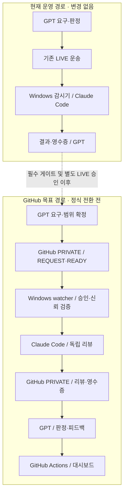

# CoWork 협업 대시보드

> **PRIVATE · GitHub에서 바로 보기 · MIGRATION_NOT_CUTOVER**
>
> 지금 운영은 Dropbox LIVE입니다. 이 화면은 GitHub 기록을 읽기 전용으로 표시합니다.

## 리뷰 처리 흐름

**REQUEST → READY → REVIEW → RECEIPT → GPT 판정**

## 협업 흐름과 상태 · 역할 기준

**협업 관리 환경** — GPT · GitHub / **업무 실행 환경** — Windows 감시기 · Claude Code

> 화살표는 설계된 경로입니다. Windows 실행·서명 검증·독립 리뷰의 PASS를 뜻하지 않습니다.

### 운영·검증 상태

| 구분 | 현재 상태 | 근거 범위 |
|---|---|---|
| 현재 운영 경로 | **기존 LIVE 유지 (문서 기준)** | GitHub 정식 전환과 별개 |
| GitHub 전환 | **기록 미관측** | 별도 명시적 승인 전 전환 금지 |
| Windows 실행·SHADOW | **기록 미관측** | 실제 호스트 실행 증거 필요 |
| Claude Code 독립 리뷰 | **기록 미관측** | 자체 시험과 구분 |
| GitHub 요청·결과·영수증 | **요청 0 · 결과 0 · 영수증 0** | PRIVATE 파일 관측 수일 뿐 완료 건수가 아님 |
| 공개 샘플 웹페이지 | **기록 미관측** | L1Work의 샘플만 PUBLIC, 실제 협업 현황 비공개 |

[전환·Windows 원문](../projects/COWORK-DROPBOX-TO-GITHUB-MIGRATION/CURRENT.md) · [대시보드 원문](../projects/COWORK-GITHUB-DASHBOARD-20261111-001/CURRENT.md)

## 한눈에 보기

| 현재 프로젝트 | GitHub REQUEST | GitHub REVIEW | GitHub RECEIPT |
|:---:|:---:|:---:|:---:|
| **5** | **0** | **0** | **0** |

**파일 수 = 검증 완료 건수 아님.** 아직 GitHub로 이관되지 않은 자료는 미확인입니다.

**[원본 HTML 파일](index.html)** · **[자동 갱신 Actions](../../.github/workflows/cowork-dashboard.yml)** · **[설명](README.md)**

HTML은 GitHub에서 소스로 표시되므로 다운로드 후 브라우저로 열 수 있습니다. 이 페이지는 GitHub에서 바로 렌더링됩니다.

---
## 상세 현황

> **MIGRATION_NOT_CUTOVER** — 운영은 Dropbox LIVE 유지. GitHub 데이터만 표시합니다.

이 문서는 GitHub Actions가 생성하는 안내 화면이며 리뷰·설치·배포 승인이나 자동 실행 결과가 아닙니다.

- 문서가 있는 프로젝트: **5개**
- GitHub REQUEST 파일 관측: **0개** (검증 안 됨)
- GitHub REVIEW 파일 관측: **0개** (검증 안 됨)
- GitHub RECEIPT 파일 관측: **0개** (검증 안 됨)

## 작업별 진행 현황 · 독립 Work Tracker

각 Work는 고유 ID로 구분. 단계/시험/리뷰 표시는 문서 신고값이며 실제 완료 검증이 아닙니다.

| Work ID | 스킬 | 진행 단계(신고) | 담당 | 시험(신고) | 독립 리뷰(신고) | 다음 조치 |
|---|---|---|---|---|---|---|
| [COWORK-DROPBOX-TO-GITHUB-MIGRATION](https://github.com/wonhwipark/CoWork-Skill-Collab/blob/main/collab/projects/COWORK-DROPBOX-TO-GITHUB-MIGRATION/CURRENT.md) | cowork-review-watcher | 개발·시험 | GPT / Claude Code | NOT_VERIFIED | NOT_RUN | 단일 최신 master r0001 20261113에서 증거 재사용·delta 시험·C/B/D/E·롤백 준비 병렬 수행, 최종 승인 항목 일괄 정리. Bridge/Dropbox 갱신기 Stop 승인 대기. ACTIVE_PROVIDER=NONE, LIVE 미승인. |
| [COWORK-GITHUB-DASHBOARD-20261111-001](https://github.com/wonhwipark/CoWork-Skill-Collab/blob/main/collab/projects/COWORK-GITHUB-DASHBOARD-20261111-001/CURRENT.md) | cowork-dashboard | 개발·시험 | GPT | PASS | NOT_RUN | Executive Work Tracker 화면·Pages 배포 검증 및 사용자 확인 |
| [COWORK-SKILL-DISCOVERY-20261112-001](https://github.com/wonhwipark/CoWork-Skill-Collab/blob/main/collab/projects/COWORK-SKILL-DISCOVERY-20261112-001/CURRENT.md) | skill-discovery | GPT 판정 | GPT | NOT_VERIFIED | NOT_RUN | 스킬 18개 원본 대조 미확인 항목 판정 |
| [JOBLIST-NRTX-20261112-001](https://github.com/wonhwipark/CoWork-Skill-Collab/blob/main/collab/projects/JOBLIST-NRTX-20261112-001/CURRENT.md) | job-list | 개발·시험 | GPT | PASS | NOT_RUN | 호스트 G0 확인 전 후보 패키지 검증 범위 유지 |
| [L1-WORKSPACE-RAG-20261111-001](https://github.com/wonhwipark/CoWork-Skill-Collab/blob/main/collab/projects/L1-WORKSPACE-RAG-20261111-001/CURRENT.md) | l1-knowledge-updater | 요구·범위 | GPT | NOT_VERIFIED | NOT_RUN | 업무 실행 환경 G0 결과 확인 후 설계 검증 |

스킬별 병렬 작업은 각 프로젝트의 TRACKER.json으로 등록합니다. 등록 전에는 확인되지 않은 실제 진행률을 추정하지 않습니다.

### 프로젝트별 상태 원문

| 프로젝트 | 문서상 상태 | 근거 |
|---|---|---|
| COWORK-DROPBOX-TO-GITHUB-MIGRATION | 전환 전 | [CURRENT.md](https://github.com/wonhwipark/CoWork-Skill-Collab/blob/main/collab/projects/COWORK-DROPBOX-TO-GITHUB-MIGRATION/CURRENT.md) |
| COWORK-GITHUB-DASHBOARD-20261111-001 | 전환 전 | [CURRENT.md](https://github.com/wonhwipark/CoWork-Skill-Collab/blob/main/collab/projects/COWORK-GITHUB-DASHBOARD-20261111-001/CURRENT.md) |
| COWORK-SKILL-DISCOVERY-20261112-001 | 상태 확인 필요 | [CURRENT.md](https://github.com/wonhwipark/CoWork-Skill-Collab/blob/main/collab/projects/COWORK-SKILL-DISCOVERY-20261112-001/CURRENT.md) |
| JOBLIST-NRTX-20261112-001 | 상태 확인 필요 | [CURRENT.md](https://github.com/wonhwipark/CoWork-Skill-Collab/blob/main/collab/projects/JOBLIST-NRTX-20261112-001/CURRENT.md) |
| L1-WORKSPACE-RAG-20261111-001 | 문서상 진행 | [CURRENT.md](https://github.com/wonhwipark/CoWork-Skill-Collab/blob/main/collab/projects/L1-WORKSPACE-RAG-20261111-001/CURRENT.md) |

미이관 파일이나 승인·서명 검증 결과가 없어도, 이 화면은 이를 임의로 성공/0건 완료 처리하지 않습니다.

## GitHub 리뷰·GPT 판정 연결

문서 연결은 승인 서명·운영 실행 검증이 아닙니다.

| 요청 | Work | 단계 | GPT 판정 |
|---|---|---|---|
| 미이관 | - | 미확인 | - |

비차단 지적도 GPT 판정 기록 전에는 해결 처리하지 않습니다.
