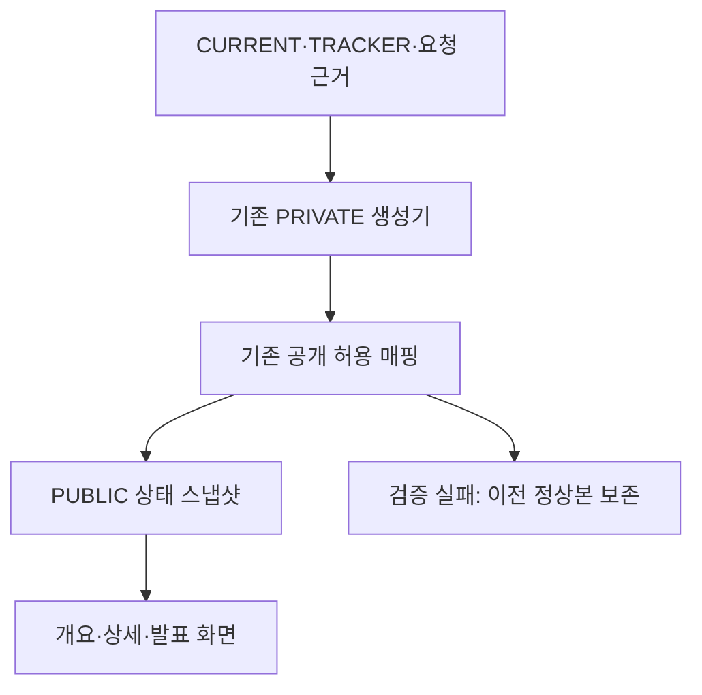

# 발표용 CoWork 대시보드 정보·상태 정합성 개선 설계 r0001

- 기준: 2026-11-15 KST / Parent Work: COWORK-GITHUB-DASHBOARD-20261111-001
- 상태: DESIGN_PROPOSED_FOR_INDEPENDENT_REVIEW. 설계 작성·리뷰 요청만 승인된 작업이며 실제 UI·공개 정책·배포·운영 변경은 아직 없음.
- 목표: 발표 참석자가 첫 화면에서 무엇을 해결하는지, 무엇을 끝냈는지, 현재 어디서 기다리는지, 누가 다음에 무엇을 하는지 설명할 수 있게 구성.
- 기존 URL/Executive 스타일/5개 공개 업무 범주/최근 인계 3건/기존 Actions·exporter·120초 polling 재사용. 새 Site·DB·범용 RAG/원장·상시 감시 추가 없음.

## 1. 확인 근거와 문제
| ID | 직접 확인한 범위 | 결과와 한계 |
|---|---|---|
| E01 | 공개 Pages 실제 브라우저의 개요·지식 설계 상세 | 운영 배지 '활성 리뷰 제공자 없음/전환 전'; 지식 구조 설계 '단계 미확인'; 여러 카드에 같은 일반 시험/다음 조치 문구. 발표용 성과·작업 경계가 보이지 않음 |
| E02 | 이관 CURRENT 최상단 및 PUBLIC status.json | PRIVATE는 GITHUB/LIVE/호스트 적용 수용, 공개는 NONE/전환 전. 공개 generated_at=2026-11-14T16:20:47Z(11/15 01:20:47 KST). LIVE 완료는 호스트 보고와 원격 리뷰 근거를 종합한 판정이며 장기 운영/실알림 검증과 별개 |
| E03 | 고정 work_tracker.py와 현재 L1 TRACKER 격리 실행 | self_test·independent_review의 긴 설명 문자열이 허용 enum 밖이라 _registered()가 None 반환. 동일 데이터의 두 값만 정상 enum으로 바꾼 합성 비교는 수용. 실제 Tracker 무변경. next_action은 165자 절단되어 뒤에 붙인 새 요청 안내도 앞 화면에서 소실 가능 |
| E04 | public_sync.py 정적 코드 | _read_active_provider()는 NONE/DROPBOX만 수용하고 GITHUB는 SafetyBlock. build_payload()는 MIGRATION_NOT_CUTOVER만 수용. 승인된 LIVE 전환 이후 공개 생성과 양립하지 않음. 실패 Action 로그의 직접 원인까지 확인한 것은 아님 |
| E05 | 기존 Work→Knowledge 요청 상태와 v0.2.20 호스트 preflight 보고 | 요청·설계 ZIP 적합성 PASS 보고, 운영 watcher WAIT_INPUT(READY 없음) 관측. 형식 검증 통과와 독립 리뷰 실행은 다름. 이번 대시보드 설계 리뷰와 별개 ID |
| E06 | PUBLIC exporter·공개 정책 | 다섯 범주/고정 라벨·동작만 내보내며 자유 next_action·PRIVATE ID·링크·영수증을 차단. 가독성 향상 때문에 원문 공개를 허용하지 않음 |

E03의 enum 정상화는 진단용 합성 데이터이며 실제 시험/리뷰 상태를 재판정한 작업이 아님. 과거 PASS 서술을 전역 현재 상태로 가져오지 않음. source 파일별 Git blob과 원문 snapshot은 EVIDENCE.md 및 source/에 고정.

## 2. 설계 결정과 범위
| 결정 | 방향 | 최소 변경 |
|---|---|---|
| D01 기존 UI·파이프라인 | REUSE | 기존 URL, HTML/JS, generate/work_tracker/public_sync/Actions 유지 |
| D02 현재 상태 연결 | CONNECT | 최신 CURRENT의 확정 상태·각 요청 증거를 연결; 과거 문장/긴 설명을 enum 필드에 넣지 않음 |
| D03 GITHUB/LIVE 공개 대응 | 최소 EXTEND 제안 | 별도 수용된 전환 판정에 대응하는 고정 공개 라벨·enum만 추가. 미지 provider/잘못된 증거는 계속 차단. 현재 정책의 전환 전 전용 규칙을 소급 무효화하지 않고 리뷰 후 최소 개정 대상으로 명시 |
| D04 발표용 작업 요약 | 최소 EXTEND 제안 | 기존 공개 범주 안에서 승인된 업무명/성과/대기/다음 역할·동작의 고정 코드→문구 매핑. 자유 원문 복제 금지 |
| D05 새 엔진/DB/별도 대시보드 | DEFER | 현재 문제 해결에 불필요 |
| D06 운영 실행 | 범위 밖 | watcher/DB/Task/토큰/서명/리뷰 비용 정책/Job/Knowledge 변경 없음 |

이번 사용자 지시는 설계 작성과 설계 독립 리뷰 요청. 공개 허용 범위·schema·코드 변경/배포를 이번 커밋으로 적용하지 않는다. 개인/그룹 L1 지식 설계와 다른 요청의 승인을 변경하지 않는다.

## 3. 발표 화면의 정보 순서
### 3.1 첫 화면
1. 한 문장 목표: '개발·분석 결과를 독립 검토와 지식 재사용으로 연결하는 협업 체계'.
2. 근거 있는 최신 성과 1~3건. 완료일/검증 범위가 확인되지 않은 성과는 비워두고 '근거 확인 필요'. 창작 성과/임의 진행률 없음.
3. 의미가 다른 상태를 분리: 리뷰 운송 운영 상태 / 공개 데이터 최신성 / 검토 중 요청. LIVE 운송과 개별 리뷰 완료를 같은 배지로 취급하지 않음.
4. 업무별 표: 업무명·이번 완료·현재 위치/대기 이유·다음 담당/한 행동·다음 산출물.
5. 최근 인계 3건은 문서 이력으로 유지. 피드백 자동 추정/5단계 인계 추적 부활 금지.

### 3.2 상세
업무 1개를 선택하면 동일 항목의 근거·제약을 펼침. PRIVATE는 Work/Request 정확한 링크, 실제 상태·시각·결과/영수증을 제공. PUBLIC은 허용된 일반 업무명·정형 요약만 표시. 기본 발표 화면에 긴 Work ID/내부경로/해시/원시 정책·비용/미승인 제목을 노출하지 않음.
발표 중 검색·일관된 접힘/펼침과 기존 필터 유지. 큰 화면에서 본문 18px 수준, 상태는 색+문구, 모바일 1열/가로 넘침 없음이 목표. 전체 정보 숨기는 새 전용 앱/발표 모드는 우선 만들지 않음.

### 3.3 이번 Work→Knowledge 요청의 표시안(게시 예정 문구)
| 항목 | 승인된 데이터 매핑 후의 문구 제안 |
|---|---|
| 업무 | 분석 결과를 지식으로 전환하는 흐름 검토 |
| 목적 | 같은 Work의 초안·보완·승인 게시와 결과 회수를 연결 |
| 완료 | 흐름 설계 정리 / 정식 요청·입력 자료 등록 |
| 현재 | 입력 적합성 확인 보고 · 승인 서명/READY 대기 · 독립 리뷰 미실행 |
| 다음 담당·행동 | Windows Claude Code — 기존 서명자로 승인 확인 후 READY 게시 |
| 다음 산출물 | 독립 리뷰 결과와 실행 영수증 |
| 한계 | 코드 분석·지식 게시·RAG 본문 활용의 E2E 검증은 후속 |

공개에는 alias 기반 하위 활동 요약만 제공하는 방안을 검토. PRIVATE 요청 ID를 복사하지 않고 기존 knowledge-design 범주에 연결한다. parent의 CL/PR 코드 패치·회귀 상태와 해당 설계 리뷰 상태는 서로 다른 활동으로 표시한다. 하위 활동을 전체 Work 합계에 또 더하지 않음.

## 4. 정본·상태·근거 계약
- Work 목적/범위: CURRENT 및 유효 TRACKER. self_test/independent_review/phase는 현재 허용 enum 유지; 상세 근거는 결과 문서와 링크에 둔다.
- 실제 요청 단계: 정확한 request_id/revision/ZIP hash에 연결된 REQUEST/승인·READY 검증 기록/dispatch/결과/receipt/GPT 판정. 파일 존재만으로 유효 서명·실행·완료를 단정하지 않음.
- 운영 상태: 이관 CURRENT의 최신 확정 판정과 그 근거. 보고 기반 완료는 '호스트 보고·검토 수용' 범위를 표시.
- 공개 projection: 검증된 PRIVATE 정본 → 고정 allowlist/enum 코드 매핑 → PUBLIC payload → 같은 payload로 개요·상세 일치 렌더.
- display_title/milestone/current_step/blocker/next_actor/next_action/next_artifact/updated/evidence_level은 **논리 표시 항목**이다. Kernel·운영 DB의 새 필수 필드로 확정하지 않는다. 기존 계약에서 매핑되는 항목은 재사용하고 누락만 리뷰 후 최소 추가.
- 자유 title/next_action/에러 문구를 그대로 PUBLIC으로 복제하지 않는다. alias/문구 코드 allowlist를 기존 exporter에서 관리하며 미지 코드·누락 근거는 UNKNOWN 또는 해당 출력 차단.
- Tracker 오류를 UNKNOWN으로 보이는 것과 실제 업무 상태 UNKNOWN은 구별. PRIVATE에는 INVALID_TRACKER/정확한 필드 오류를 표시하고 공개는 고정 문구 '상태 연결 확인 필요'만 허용 후보.
- phase=REVIEW는 요청을 검토 중이라는 업무 단계일 수 있으나 모델 실행 상태는 별도 '미실행/대기/실행 중/결과 수신'. 단계 위치를 완료율로 표시하지 않는다.

| 관측 근거 | 사용자 표시 | 금지 추론 |
|---|---|---|
| REQUEST만 존재 | 리뷰 요청 등록 · 실행 준비 대기 | 큐 등록/실행 완료 |
| READY 파일 관측, 호스트 검증 미확인 | READY 게시 · 유효성 확인 대기 | 서명 PASS |
| 유효 승인/READY와 디스패치 예약 | 접수·디스패치 기록 | 모델 실행/리뷰 완료 |
| 실제 실행 이벤트 | 리뷰 진행 중 | 완료 |
| 결과/receipt 관측·대상 검증 | 리뷰 결과 수신 · GPT 판정 대기 | 지적 해소/배포 |
| GPT 지적별 판정 | 판정 완료 · 보완 필요 여부 | 실제 코드 반영 |
| 응답 유실/불확실 | 실행 확인 필요 | 재리뷰 자동 호출 |
| 형식/정책 거부 | 입력 보완 필요 | 업무 자체 실패/성과 0 |

## 5. 갱신과 최신성

- 기존 변경 트리거→PRIVATE 생성/시험→PUBLIC allowlist sync→Pages→same-origin 120초 polling/탭 복귀 재조회 재사용. 이번 설계에서 OS 예약/새 백그라운드 감시/리뷰 모델 호출을 추가하지 않음.
- 브라우저 '최근 수신'은 status.json 재수신 시간. '데이터 기준'은 원본을 근거로 정상 생성한 시각. 같은 오래된 JSON을 2분마다 받는 것은 최신 업무 상태를 증명하지 않음.
- 내용 변경 시각과 마지막 원본 확인 시각은 서로 다름. 의미 상태 불변인데 타임스탬프만 바꿔 무한 PUBLIC 커밋을 만들지 않음.
- 현재 필드만으로 source의 최신 여부를 알 수 없으면 '최근 수신 성공 / 원본 최신성 미확인'. 최신 source와 export의 차이가 PRIVATE에서 확인되면 허용된 '갱신 지연' 상태를 제안. 일정 시간 경과만으로 사실이 틀렸다고 단정하지 않음.
- 필요한 freshness 표시는 기존 payload에 최소 optional 버전/정형 상태/확인 시각을 추가하는 방안을 리뷰. V1 클라이언트 호환과 엄격 허용키 검증을 동시 변경해야 하며 미구현 필드의 존재를 가정하지 않음.
- PUBLIC 검증 실패 시 본문 마지막 정상본 보존·PRIVATE 실패 원인 기록. PUBLIC의 안전한 갱신 오류 표시는 고정 health enum에 대한 별도 최소 허용 범위 검토 후 적용. 검사 완화/PRIVATE 원문 오류 유출 금지.
- 입력 snapshot commit을 고정하고 출력 재조회 검증. 갱신 레이스에서는 오래된 스냅샷이 최신 것을 덮지 않게 기존 직렬화/비교 재사용. CURRENT 문서상 상태 변화만으로 실행을 시작하지 않음.

## 6. 공개 경계와 정책 최소 개정안
1. GitHub LIVE 판정은 기존 확정 근거를 사용. PUBLIC에는 'GitHub 리뷰 운송 가동 확인 보고 / 지속 운영 검증 중' 같은 고정 문구 제안. 독립 리뷰 첫 실전/실알림/재부팅 미검증은 세부에 남김.
2. 공개 허용 기존 5범주 안의 일반 활동 요약을 먼저 개선. PRIVATE Request/Work ID, 비용/정책 값, ZIP hash, PRIVATE URL/원문/서명/개인정보는 공개 금지 유지.
3. 기존 PUBLIC 정책의 전환 전 전용 가드와 provider enum만 실제 승인된 운영 상태에 맞게 최소 개정 대상으로 제시. 새로운 모든 provider를 허용하는 wildcard/예외 우회 없음.
4. 고정 문구만으로 성과가 너무 모호하면 승인된 milestone 코드·검증 수준·next-action 코드의 작은 allowlist를 추가. 자유 텍스트 통과나 전체 schema 재설계가 아님.
5. 이번 PRIVATE 설계 게시가 위 정책/공개 항목의 실제 반영·PUBLIC 게시 승인은 아님. 독립 리뷰 후 GPT 판정과 실제 구현 범위를 확정.

## 7. 변경 후보와 책임
| 순서 | 기존 대상 | 최소 수정 제안 | 완료 근거 |
|---|---|---|---|
| P0 | work_tracker.py + 해당 TRACKER 작성 절차 | 유효 enum만 저장; 상세 설명 분리; PRIVATE 형식 오류 안내 | 실제 잘못된 등록의 회귀 반례, 정상 등록 보존 |
| P0 | generate.py/public_sync.py + PUBLIC_PAGES_DEFAULT_POLICY.md | 최신 확정 GITHUB/LIVE 상태의 안전한 enum 매핑·정책 동시 정합 | 유효 LIVE/미승인/충돌/과거 이력 반례 |
| P1 | 기존 Work 표시 매핑 | 목적·완료·대기·다음 역할/동작·산출물 코드 | 이번 요청 사례에서 개요/상세 같은 상태 |
| P1 | 기존 status.js/index.html | 상단 성과·신뢰 범위·최신성, 짧은 표/상세 | 데스크톱·모바일·실페이지 관찰 |
| P2 | 기존 sync Actions·검증 | 오류 가시성·stale/레이스·게시/readback 검증 | 실제 pipeline E2E 1건, 마지막 정상본 보존 |

순서는 구현 계획이며 이번 작업은 소스 수정/시험·배포하지 않는다. 기존 대시보드 updater·watcher의 운영 승인과 분리. 새 스킬을 만들거나 L1 Knowledge Updater가 대시보드 정본을 소유하게 하지 않음.

## 8. 수용 기준(실행 전 계획)
| ID | 검증 사례 | 기대 결과 |
|---|---|---|
| A01 | 최신 확정 GITHUB/LIVE vs 과거 NONE | 최신 근거 범위를 붙인 동일 상태를 개요·상세에 표시; 과거 문장 오인 0 |
| A02 | 원본 provider 미지/충돌/미승인 상태 | fail-closed, 마지막 정상 PUBLIC본 보존 |
| A03 | 현재 L1 Tracker 긴 상태값 | PRIVATE 필드 오류 표시; 임의 PASS/완료 변환 0 |
| A04 | 정식 요청만, READY/서명 없음 | 요청 등록/실행 준비 대기, 모델 실행 표시 0 |
| A05 | READY 파일만 있음/잘못된 서명 | 유효성 미확인 또는 입력 거부; 완료/접수 성공 승격 0 |
| A06 | 예약만 있음/중단·불확실 | 실행 완료 아님; 모델 재호출 0 |
| A07 | 결과만 있고 receipt 없거나 hash 불일치 | 결과 관측/검증 필요로 분리 |
| A08 | 같은 parent의 CLPR와 설계 리뷰 동시 존재 | 해당 활동만 변화; 서로의 PASS 승계/Work 합계 중복 0 |
| A09 | 공개 payload에 ID/PRIVATE URL/자유 오류/새 키 주입 | 출력 차단, 안전한 기존 값 보존 |
| A10 | 브라우저 수신 성공·원본 최신성 미확인 | '최신 정상'이라고 표시하지 않음 |
| A11 | 원본 무변경 장시간/고장 난 sync/순서 역전 | timestamp 의미 구분, 오래됨만으로 실패 단정 0, stale overwrite 0 |
| A12 | 1366×768 및 1920×1080 발표·390px 모바일 | 핵심 업무/완료/현재/다음 행동 가독, 가로 넘침 0; 색만으로 상태 전달 안 함 |
| A13 | 상태 1건 실제 변경→PUBLIC→Pages | 승인된 요약만 readback/실화면에 일치, 실패 시 이전본 보존 |
| A14 | 최근 공개 인계 문서 | 최신 3건만, 자동 리뷰 진행 추정 0 |
| A15 | 30초 발표 설명 리허설 | 참석자가 선택 업무의 목표/끝낸 일/대기 이유/다음 담당·행동을 설명 가능 |

A01~A15는 계획이며 이번 설계 문서 QA/격리 진단과 실제 UI 구현·독립 리뷰 PASS를 혼동하지 않는다.

## 9. 이번 작업 결과·리뷰 판정 범위
- 설계 본문/입력 근거 작성: 수행.
- 진단 E03 격리 재현: 원본 등록 거부 및 enum 정상화 합성 비교 확인. 실제 Tracker는 변경하지 않음.
- 코드/공개 정책/UI 변경/배포: NOT_RUN.
- 새 설계 독립 리뷰: 별도 요청 REQ-COWORK-DASHBOARD-PRESENTATION-20261115-001, 결과·receipt 확인 전 NOT_RUN.
- 기존 Work→Knowledge 요청 preflight PASS를 이번 설계 리뷰 PASS로 소급하지 않음.
- 이번 설계 리뷰는 R1 집중 검토 제안, POLICY-STATIC-V1 상한 $1/1회. 입력은 DESIGN/EVIDENCE/질문 우선이며 배포·운영 전체 구조 심층검증으로 확대하지 않음. 예산 부족은 PARTIAL_SCOPE, 재호출/자동 상향 없음.
