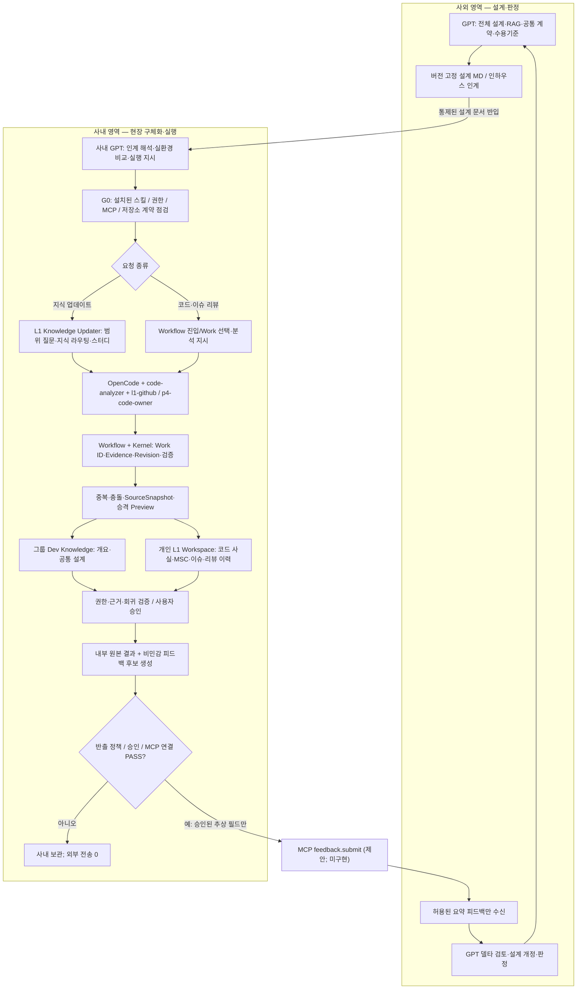

# L1 지식 설계 — 사외·사내 E2E 협업 아키텍처 r0001

- 작성: 2026-11-11 KST
- 분류: **비민감 공통 설계 제안** / 구현·운영 적용 승인 아님
- 기준: L1 Workspace RAG r0002, Review Ledger Step 2, G0 Partial Audit, 사용자 설명에 따른 사내 Knowledge Updater 동작
- 상태: `DESIGN_PROPOSAL / INHOUSE_G0_NOT_VERIFIED / MCP_CONNECTOR_NOT_IMPLEMENTED / RAG_M1_BLOCKED`
- 운영: `MIGRATION_NOT_CUTOVER / DROPBOX_LIVE` 유지. 기존 운영 watcher, DB, Job, Telegram, 스킬 설치본 불변.

## A. 전체 구조

### 책임과 원칙

1. **사외 GPT**는 아키텍처 정합성·스킬 경계·RAG 정책·수용기준을 제안 및 판정한다. 회사 소스/로그/내부 스키마 원문은 받지 않는다.
2. **사내 GPT(웹·텍스트 중심)**는 사외의 비민감 설계 MD를 실제 보유 스킬·제품·담당 블록에 맞춰 현지화한다. 자동 API/MCP 연결이나 직접 코드 접근은 확인되지 않았다.
3. **사내 OpenCode/Agent**는 승인된 소스·Git·P4·Jira 도구로 분석·필요 시 격리 개발/시험한다. 사내 Knowledge Updater는 자연어 지식 업데이트 요청의 사용자 진입점 및 지식 분류 조정자다. 새로 복제 개발하지 않는다.
4. **Workflow + Kernel**이 Work와 Evidence 이력의 소유자다. `ReviewSession/Finding`은 기존 Evidence ID를 연결하는 *논리 계약*이며 미등록 `review_kind`를 Kernel의 `evidence.kind`로 직접 쓰지 않는다.
5. **그룹 Dev Knowledge**는 팀 공통·검증된 개요/HLD/인터페이스 정본; **개인 Workspace**는 브랜치/리비전별 상세 CODE_FACTS·AS-IS MSC·이슈/리뷰 이력. 후보 비교·Preview·승인 전 덮어쓰기 금지.
6. **RAG**는 권한·제품·브랜치·SourceSnapshot과 실제 검색 본문·Provider 최종 입력 및 digest가 일치할 때만 `VERIFIED`. M1은 현재 `BLOCKED`다.
7. **사내 → 사외**는 개별 회사 데이터의 이동이 아니라 *승인된 비민감 상태/변경 유형*의 전달이다. MCP는 이 전송의 표준 인터페이스 후보일 뿐 보안 승인 또는 방화벽 우회 수단이 아니다.

## B. 사용 시나리오

**지식 업데이트**: 사용자 자연어 → Updater 대상 블록·폴더 질문 → 설치 도구/SourceSnapshot 식별 → Code Analyzer 코드 근거 분석 → Work/Evidence 축적 → 그룹 개요와 개인 상세로 후보 분류 → 중복·충돌 Preview → 사내 승인을 거쳐 각각 반영 → 학습/스터디 → 비민감 변경 상태만 MCP 피드백 후보.

**코드리뷰·이슈리뷰**: 사용자 요청 → Workflow Work ID 연결(직접 `code-analyzer` 호출 시 자동 연결은 목표 기능으로, 현행 확인 전 보장하지 않음) → `l1-github` Git PR SHA/diff 또는 `p4-code-owner` Jira/P4 CL 이력 → `code-analyzer` 의미·원인·MSC 분석 → ReviewSession/Finding/EvidenceRef 논리 연결 → 판정·재검증 이벤트 누적 → Knowledge Updater 승격 Preview(선택) → 승인된 저장.

**사내 스킬 개발 피드백**: 사내 GPT가 설계를 현장 제약으로 조정 → OpenCode가 격리 후보 구현/시험 → 사내 원본 결과 보존 → 반출 정책이 승인한 변경 **코드와 상태 값만** MCP를 통해 외부에 전달 → 사외 GPT가 공통 설계만 개정한다. 기존 사내 원본을 외부 파일로 복제하지 않는다.

## C. 우선 구현·검증 순서

- **G0 (최우선)**: 기존 G0 H01–H04를 폐기하지 말고 `L1 Knowledge Updater`의 입력/출력, 중복/승격/스터디, 실설치 스킬 및 MCP 유무를 추가 검증. 상태 `NOT_VERIFIED`.
- **G1 설계 적합성**: Updater ↔ Workflow/Kernel 역할·쓰기 소유권 확정; 설치 없이 synthetic 시나리오 및 권한 차단 시험.
- **G2 사내 격리 연계**: 사용자가 허용한 비운영 샘플로 Work/Evidence/지식 Preview·코드리뷰·이슈리뷰 실행. 운영 설치/DB/스킬은 변경하지 않음.
- **G3 사외 피드백**: 최소 allowlist JSON 계약, 승인 게이트, 기밀 스캔, 송수신 영수증, 중복 차단 및 원격 readback 실증. 기본값 `DISABLED`.
- **G4 RAG M1**: 실제 Provider 입력 본문·digest·revision·권한 검증과 부정시험 완료 전 `BLOCKED` 유지.
- **운영/배포**: 내부 설치·그룹 지식 반영·대외 전송·유료 리뷰·LIVE 전환은 각각 필요한 별도 승인을 지킨다.

## D. 이전 인계서와 차이

기존 `L1_REVIEW_ACCUMULATION_INHOUSE_G0_READONLY_HANDOFF_r0001_20261111.md`는 **코드리뷰 누적용 호스트 I/O 점검**이다. 이번 인계서는 사외/사내 설계 왕복, 사내 GPT·Knowledge Updater, 그룹/개인 지식 라우팅, MCP 반출 계약을 포괄하는 **상위 흐름**이다. 기존 G0 진단의 사실과 시험은 유지하고, 실행 목적·후속 경로만 확장한다.

## E. 보안 및 불변조건

- 내부 코드·사내 Git/P4 경로·Jira·고객 자료·특허·원본 MSC·개인정보·조직 비밀·토큰/키는 GitHub PRIVATE를 포함한 외부 영역에 게시 금지.
- MCP 연결 자체가 불확실/미승인인 경우 `NOT_RUN`, 반출 허용이 불확실한 경우 `BLOCKED`; 자동 동기화 없음.
- 사내 GPT의 Markdown 설명과 OpenCode 개발자 자기 시험은 독립 리뷰나 운영 승인으로 승격되지 않는다.
- 운영 LIVE는 기존 Dropbox 그대로. 새로운 feedback MCP 제안은 기존 리뷰 watcher의 `REQUEST/READY`를 대체/호출하지 않는다.
