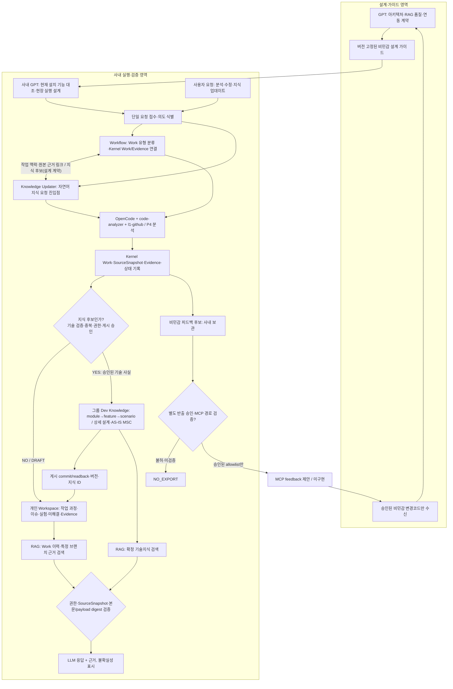

# L1 지식 설계 — Workflow × Knowledge Updater 통합 아키텍처 r0002

- 개정: r0002 / 2026-11-11 KST
- 성격: **사용자 합의에 따른 목표 구조·연동 계약 제안**. 실제 설치·호스트 실행·자동 게시가 검증되었다는 뜻이 아님.
- 상위 기준: r0001 E2E 협업 구조, L1 Workspace RAG r0002(브랜치/Work 구분), MCP feedback 0.1, Review Ledger/G0 기존 결과. 기존 문서·증거 보존.
- 상태: `DESIGN_ONLY / INHOUSE_UPDATER_INTEGRATION_NOT_VERIFIED / GROUP_PUBLISH_NOT_RUN / RAG_M1_BLOCKED`
- 운영 불변: `MIGRATION_NOT_CUTOVER / DROPBOX_LIVE`; 기존 Workspace, 그룹 지식 정본, Kernel/Workflow 설치본, watcher/DB/Job/Telegram, PUBLIC 배포, MCP 전송 미변경.

## 1. 핵심 변경 결정 (r0001 → r0002)

2026-11-11 사용자 전달 그룹 회의 결론: 그룹 Eron Software Dev Knowledge에 **모듈별 상세 코드 동작·설계·검증된 MSC까지 등록할 수 있음**. 이는 **내용 범위 허용**이며 모든 생성 결과의 자동 업로드·무심사 덮어쓰기 승인은 아님.

| 항목 | 기존 r0001 설계 | 이번 r0002 목표 |
|---|---|---|
| 그룹 Dev Knowledge | 개요·공통 HLD·인터페이스 중심 | **검증된 기술지식의 정본**: 개요부터 상세 설계, 코드 동작, AS-IS MSC, 시나리오, 검증된 이슈 해결 지식 |
| 개인 Eron Workspace | 상세 코드/MSC 중심 저장 + 작업 관리 | **Work·진행 상태·개발 이력 정본**: 분석 초안, 수정 과정, 시험·리뷰·Evidence, 브랜치별 작업 근거, 그룹 게시 링크 |
| Workflow (`l1-fix-workflow`) | Work 수행 및 기록, 부분 지식 입력 | **작업 오케스트레이션/분류 책임**: 요청 의도 판정, ISSUE/FEATURE/REFACTOR/DESIGN/CODE_ANALYSIS 후보, Kernel Work 연결, 분석 단계·검증·게시 후보 인계 |
| Knowledge Updater | 자연어 지식 진입점 + 그룹/개인 분리 | **기술 지식 선별·출판 조정**: module→feature→scenario 연결, 버전/중복/충돌 점검, 게시 Preview·승인, 그룹 정본 등록과 Workspace 역링크(목표; 실구현 검증 필요) |
| Kernel | Work/Evidence 단일 원장 | 변경 없음. Work ID, 진행 상태, Evidence, Snapshot/README Export의 소유권 유지 |
| RAG | 두 저장소의 상세/공통 구분 | 그룹은 검증된 기술 설명의 우선 소스, Workspace는 최신 작업·브랜치 근거의 소스. source revision·권한·실제 Provider 본문 소비 검증 필수 |

**반드시 분리:** `work_category` = 작업 목적; `artifact_kind` = CODE_FACTS/MSC_AS_IS/MSC_TO_BE 등 문서 종류; `module/feature/scenario` = 기술 분류; `profile/work_purpose` = 기존 실행 계약. 현 `work_category` 필드는 구현 확인 전 제안일 뿐.

## 2. 전체 목표 구조도



**단일 오케스트레이션 원칙:** 사용자 진입 채널이 Updater든 Workflow든 새 Work 중복 생성 금지. 기존 구현의 단일 라우터/워크플로 진입점을 G0에서 확인하고 연결 방식을 결정한다. 위 도식은 목표 책임 분리이며 설치된 호출 관계에 대한 실측 증거가 아니다.

## 3. 저장소·소유권과 그룹 승격 기준

### 개인 Eron Workspace — 작업 관리 정본

- Work ID, `ISSUE / FEATURE / REFACTOR / DESIGN / CODE_ANALYSIS / UNCLASSIFIED` 후보 분류, 진행 상태, 변경/결정/리뷰/시험 이력, 미해결 사항, 분석 초안, 실패한 가설, 시점별 SourceSnapshot, Evidence.
- Work 내 MSC/코드 분석을 **작업 증거로 보존**할 수 있다. 상세 기술 설명의 최종 공유 정본만 그룹으로 발행한다. Work 원장/테스트 기록을 억지로 그룹으로 이동하지 않는다.
- 기존 `record.json` SSOT, `README/index/문서안내` Kernel exporter, Work ID, Cross-host/legacy 상태 불변. `work_category` 신규 필드 도입 전 기존 스키마와 실제 설치본 확인.
- 링크: `work_id → publication_id / knowledge_id / pinned_source_revision / publication_revision / approval_receipt`는 별도 연결 메타데이터 후보. 기존 Kernel Evidence 등록 슬롯에 미등록 필드를 직접 쓰지 않는다.

### 그룹 Eron Software Dev Knowledge — 검증된 기술 지식 정본

- 기술 탐색: `module → feature → scenario`. 내용: 기능·HLD/상세설계·인터페이스·확인된 AS-IS 코드 흐름 및 MSC·유효한 이슈 해결 지식.
- 각 게시 단위는 `knowledge_id`, module/feature/scenario, `artifact_kind`, `source_system`(Git/P4), `pinned_source_revision`, branch/범위/검증 시점, `evidence_ref`, `validation_state`, `publication_revision`, 승인 주체/영수증, 원본 Work 링크를 보유하도록 **제안**.
- 현재 코드 분석만으로 충분히 검증된 MSC도 게시 후보. 그러나 단순 코드 수정 완료가 자동 승인 조건은 아님. `MSC_TO_BE`는 적용·검증 전에는 설계 예측으로 별도 표기, AS-IS 사실로 승격 금지.
- 게시 전에 기존 정본 중복·의미 충돌·권한/정보등급·호환성·제품·브랜치/CL 차이 Preview를 수행. 그룹 소유자 승인 없이는 자동 게시/덮어쓰기 금지.
- 그룹 등록 후 개별 Work/개발 이력은 삭제·이동하지 않고 그룹 정본에 연결. 그룹 정본은 특정 브랜치에만 유효할 수 있으므로 전체 프로젝트의 불변 진실로 일반화 금지.

### 관계 예시

- 개인 Work `ISSUE` (DRX timing 수정) → `CODE_FACTS` + `MSC_AS_IS` → 승인된 그룹 지식 `DRX / Timing / Wakeup`.
- 개인 Work `CODE_ANALYSIS` (Branch B 현재 DRX 분석) → Branch B **고정 SHA** → 승인 시 **그 범위 한정** 그룹 AS-IS MSC 발행.
- 하나의 Work에서 여러 기술 지식을 발행하거나 하나의 기술 지식에 여러 Work가 기여할 수 있음. N:M 링크와 버전/중복 방지 필요.

## 4. 스킬 책임·연계점

| 주체 | 소유 책임 | 금지하거나 확인할 항목 |
|---|---|---|
| 사내 GPT | 가이드 해석, 설치본 비교, 현장 오케스트레이션 계획·판정 | 소스/실행 결과를 확인하지 않고 PASS 금지 |
| Workflow | 작업 intent 분류, Work 개시/재개, 분석 호출, 상태 전이, Knowledge 후보 인계 | 그룹 정본 직접 임의 쓰기·Updater 역할 재구현 금지 |
| Knowledge Updater | 지식 intent 수집, 지식 후보 기술분류, 그룹 게시 적합성·Preview·승인·스터디(실구현 확인) | Kernel 상태 중복 소유·무조건 그룹 게시 금지 |
| Kernel | Work 원장/ID, Evidence registry, Snapshot/Export | 미등록 kind/provider 또는 임의 메타 필드 삽입 금지 |
| code-analyzer | CODE_FACTS·원인·AS-IS/TO-BE MSC 분석 | 고정 revision/근거 없는 VERIFIED 금지 |
| l1-github / p4-code-owner | Git branch/commit, PR 차이, P4 file#rev/CL/Jira 근거 | 서로 다른 source/branch 혼합 금지 |
| RAG driver / Provider | 검증된 body+anchor+source scope의 실제 모델 입력 | 검색 링크만으로 RAG 동작 PASS 금지 |
| doc-converter / hld-composer | 출력 표현·설계 문서 변환 지원(실제 설치 필요) | 중복 신규 도구 생성 금지 |

## 5. 사내 연계 인터페이스 — 최소 논리 계약(구현 사실 아님)

```text
classify_request(request, work_context?) -> intent, work_category_candidate, confidence, requires_user_decision
open_or_resume_work(intent, source_scope) -> work_id, existing_or_created, kernel_receipt
analyze_source(work_id, SourceSnapshot) -> CODE_FACTS/MSC + evidence_refs + validation_state
propose_knowledge(work_id, artifacts) -> knowledge_candidates[] {module,feature,scenario,kind,source_rev,evidence_ref}
preview_publication(candidate) -> duplicate/conflict/permission/revision verdict
approve_and_publish(candidate, approval) -> knowledge_id, publication_revision, commit/readback_receipt
link_publication(work_id, knowledge_id, immutable_revision) -> link receipt
retrieve_for_rag(query, scope) -> verified body/anchor + scope/evidence; provider_consume receipt
```

- 실제 API 이름·필드·인수·프로세스는 G0에서 실측 후 교체; 새 인터페이스를 앞서 구현하지 않는다.
- Updater 자연어 진입 시 Workflow/Kernel이 중복 Work를 만들지 않는지 검증. Workflow 진입 시에도 Updater가 동일 기술 후보를 중복 발행하지 않도록 idempotency/handshake 필요.
- 게시와 Workspace 링크는 각 원장 소유권을 유지하는 분리 트랜잭션. 게시 성공·링크 실패 시 불일치를 숨기지 않고 복구 큐/영수증으로 정산; 같은 게시의 중복 등록 금지.
- RAG M1은 여전히 `BLOCKED`. RAG 검증 상태와 그룹 게시 성공은 **독립 게이트**.

## 6. G0→G3 인수 기준 / 부정시험

- **G0 READ_ONLY**: Workflow/Updater 실제 설치 버전·호출 진입점·소유권/중복·MCP 연결, Kernel registry/export, CODE_FACTS/MSC 출력, 그룹 지식 쓰기 권한 및 현재 폴더 구조, Work category 필드, source-root/Job gate 확인. 미조회 `NOT_VERIFIED`.
- **G1 합성 설계**: (A) 진행 중 ISSUE는 Workspace 유지, (B) 기존 코드 VERIFIED MSC는 그룹 후보, (C) 수정 전 TO-BE MSC는 그룹 AS-IS 게시 거부, (D) Branch A/B 불일치 거부, (E) 승인 없는 게시 0, (F) Updater/Workflow 두 진입점 동일 요청 중복 Work 0.
- **G2 격리 연동**: 허용된 샘플에서 Work → CODE_FACTS/MSC → Preview → 승인 샌드박스 게시 → source/Work 역링크/재조회. 운영 그룹 저장소/DB·설치본 수정 없음.
- **G3 운영 게시 제안 판정**: 권한 소유자 승인·롤백·충돌·시점별 검증·회귀·독립 리뷰 등 충족 후 별도 진행. 그룹 지식 자동 Write는 **별도 명시적 승인**.
- **RAG M1 독립 조건**: 실제 source-revision/권한/body/driver payload digest와 독립 영수증 실측 전 BLOCKED.
- **MCP feedback**: 기존 `l1/mcp-feedback/0.1` 계약 유지; 수정 사항은 `WORKFLOW_INTEGRATION / KNOWLEDGE_ROUTING`의 비민감 enum으로만 후보화. 허가 없는 사외 반출 금지.

## 7. 이번 설계 변경의 실제 완료 범위

- `DESIGN_DRAFT=COMPLETE`: 상세 저장소 역할 재정의 및 G0 인계 기준을 새 버전으로 작성.
- `INHOUSE_INVENTORY=NOT_RUN`, `UPDATER_WORKFLOW_E2E=NOT_RUN`, `GROUP_PUBLICATION=NOT_RUN`, `RAG_PROVIDER_INPUT=BLOCKED`, `MCP_EXPORT=NOT_RUN`, `INDEPENDENT_CLAUDE_REVIEW=NOT_RUN`.
- 기존 배포 ZIP, 사내 Git, 그룹 지식 정본, 운영 Work/DB/Job/자동화, watcher 및 Dropbox LIVE 변경 없음.

**다음 한 동작:** r0002 사내 GPT 인계서로 설치된 Workflow·Knowledge Updater의 역할·입출력·중복 기능을 G0 읽기 전용으로 확인하고 연결 옵션을 `REUSE / CONNECT / EXTEND / DEFER`로 판정한다.
