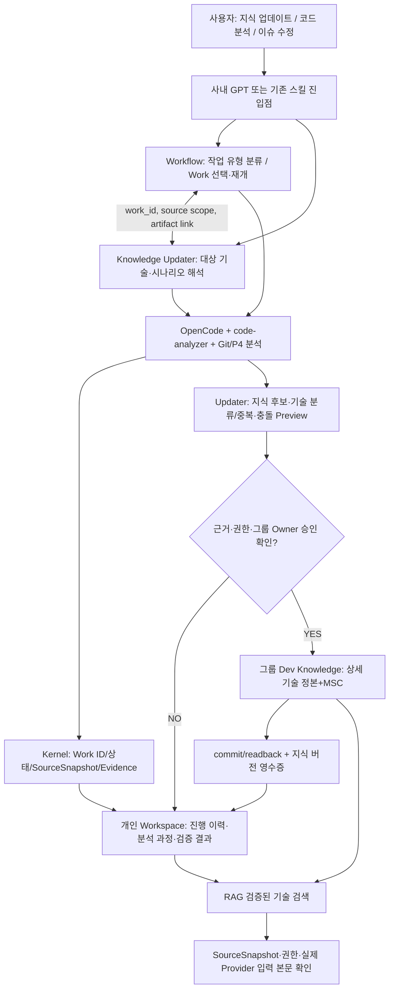

# 사내 GPT / OpenCode 인계 — Workflow × Knowledge Updater 연동 검토 r0002

- 작성일: 2026-11-11 KST
- 용도: 사내 GPT가 기존 대화를 몰라도 독립적으로 수행할 수 있는 통합 설계·읽기 전용 확인 문서
- 단계: `G0_READ_ONLY + G1_DESIGN`. 실제 운영 설치·그룹 지식 등록·코드 수정·자동 전송은 승인하지 않음.
- 원칙: 사내에 이미 만들어진 L1 Knowledge Updater를 재사용한다. 실제 기능은 설치본과 시험 근거로 확인하며 사용자 설명을 기능 PASS로 대체하지 않는다.
- 사외 협업 서비스/저장소명·외부 인증·외부 경로에 대한 사내 실행 의존성 없음.

## 1. 신규 합의에 따른 목표

**개인 Eron Workspace = 작업 관리·진행 상태·개발 히스토리의 정본.**
ISSUE, FEATURE, REFACTOR, DESIGN, CODE_ANALYSIS 등 Work 유형의 분류 후보, Work ID, 진행·수정·시험·리뷰·미해결 내역, CODE_FACTS·MSC 초안, 소스 스냅샷/Evidence, 게시 결과 링크를 유지한다.

**그룹 Eron Software Dev Knowledge = 검증된 L1 기술 지식의 정본.**
`module → feature → scenario` 아래 모듈 설명, HLD/상세 설계, 현재 소스에서 검증된 코드 동작, AS-IS MSC, 검증된 이슈 해결 노트를 공유한다. 현재 코드에 이미 존재하는 동작의 검증된 MSC는 새 수정이 없어도 게시 후보가 된다. 반면 구현 전 TO-BE 흐름은 현재 동작인 것처럼 게시하지 않는다.

그룹 회의에서 상세 설계·MSC 등록이 허용됐다는 사용자 전달 사실은 **내용 범위 허용**이며, 임의의 자동 쓰기/덮어쓰기 승인이 아니다. 실제 등록 권한, 소유자 승인·중복·버전 정책을 먼저 실측한다.

## 2. 전체 실행 목표



도식은 **목표 책임 분리**이며 현재 API나 자동 연결의 구현을 보장하지 않는다. Updater로 먼저 진입하더라도 동일 요청이 Workflow에서 중복 Work를 만들면 안 된다.

## 3. 스킬 책임 요약과 G0 질문

| 스킬 | 목표 역할 | 실제 확인할 계약 |
|---|---|---|
| L1 Knowledge Updater (사내 개발) | 자연어 지식 업데이트·기술 분류·그룹 게시 후보/Preview·학습 | 실제 호출 entrypoint, 그룹/개인 저장 함수, 소유권/승인/중복 확인, Workflow 연결 유무 |
| `l1-fix-workflow` | 사용자 요청 intent 분류, ISSUE/FEATURE/REFACTOR/DESIGN/CODE_ANALYSIS Work 제어, 분석 단계 지휘 | Work 분류 필드 존재/부재, Work 생성/재개, Updater 호출과 사이드이펙트 |
| `work-ledger-kernel` | Work ID·상태·record.json 원장·Evidence·Snapshot/export | Evidence 허용 slot, 기존 인덱스/README 재생성, 사용자 지정 category 저장 가능성 |
| `code-analyzer` | 코드 사실, 원인 분석, MSC_AS_IS/MSC_TO_BE 산출 | 실제 CODE_FACTS/MSC 출력 계약, 소스 revision·scope·evidence |
| `l1-github` | Git branch/commit/PR diff, work_docs 연계 | 고정 전체 commit SHA, dirty/untracked, push guard |
| `p4-code-owner` | P4 file#rev/CL, Jira 이력·소유권 단서 | 실제 rev 증거; 담당자/CL 포함만으로 원인 확정 금지 |
| `doc-converter / hld-composer` | 분석 문서/MSC/HLD 표현 재사용 | 현행 변환 기능 재사용 가능 여부 |
| `job-list / RAG driver` | 작업 도구 호출·최종 검색 본문 실제 모델 입력 확인 | source root/권한/driver payload digest/Receipt 여부 |

존재하지 않는 스킬이나 실제 미설치 기능을 PASS로 기록하지 말 것. Kernel Evidence registry에 새 review kind·임의 필드를 바로 쓰지 말 것.

## 4. 혼동하면 안 되는 4개 분류 축

- **Work 목적:** `work_category = ISSUE / FEATURE / REFACTOR / DESIGN / CODE_ANALYSIS / UNCLASSIFIED`는 새 분류 메타데이터 **제안**. 설치된 기능인지 G0 검증 전 단정 금지. 작업 유형의 후보 제안은 Workflow 소유.
- **문서 종류:** `artifact_kind = CODE_FACTS / MSC_AS_IS / MSC_TO_BE / HLD / TEST_RESULT`. ISSUE Work에서도 MSC_AS_IS가 만들어질 수 있음.
- **기술 탐색:** `module_id / feature_id / scenario_id / knowledge_tags`. Knowledge Updater가 분류 후보 생성.
- **실행 상태:** 기존 Kernel `work_purpose/profile/status`. Work 목적/기술 분류와 통합 금지.

예: DRX 타이밍 문제를 수정하는 ISSUE Work에서 만든 AS-IS MSC는 `ISSUE + MSC_AS_IS`로 기록한다. 특정 Branch B DRX 자체를 분석하는 독립 Work는 `CODE_ANALYSIS + MSC_AS_IS`. 그룹 기술지식에는 해당 브랜치의 전체 고정 commit SHA/P4 실제 revision과 검증 범위를 함께 표기하도록 설계한다.

## 5. 사내 G0 읽기 전용 원샷 조사

1. **설치·버전·권한:** Knowledge Updater, Workflow, Kernel, Analyzer, Git/P4, 그룹 지식, Workspace의 실제 설치/entrypoints, 역할·소유권·읽기/쓰기 부작용을 확인한다. 모르면 `NOT_VERIFIED`.
2. **요청 호출 체인:** 지식 업데이트 요청과 이슈·코드 분석 요청을 입력으로, 누가 Workflow를 호출하고 Work ID를 만들며 Updater로 넘기는지 실제 소스·템플릿 근거를 찾는다.
3. **저장소 계약:** Workspace Work/상태/정본 규칙과 그룹 지식 module→feature→scenario tree, 기존 MSC 저장 방식, 승인·게시 권한·중복·충돌 정책을 확인한다. 그룹 저장소 운영본에는 쓰지 않는다.
4. **분석 증거:** Git branch 포인터와 immutable commit, P4 CL와 실제 file#rev/haveRev, dirty/untracked, CODE_FACTS/MSC 출력 및 Evidence 등록 슬롯을 조사한다.
5. **RAG:** 현재 검색 링크와 실제 retrieved body→driver→Provider 소비를 구분. 최종 payload/evidence가 없으면 `M1=BLOCKED`.
6. **Gap/최소 수정:** 기존에 구현된 기능은 `REUSE`, 호출 연결만 필요한 부분은 `CONNECT`, 기존 스킬 일부 수정 필요 시 `EXTEND`, 새 RAG DB/새 독립 오케스트레이터 등 불필요한 확장은 `DEFER`로 분류한다.
7. **출력:** 내부 상세 결과와 공유 검토가 가능한 추상 상태를 분리한다. 실 코드·MSC 원문·내부 repo 경로·로그·인증정보는 승인된 사내 공간에만 보존. 외부 전송 기본값 `NO_EXPORT`.

## 6. 최소 인터페이스 계약 후보 — 실제 API라 가정하지 않음

```text
classify_or_resume_request(intent, source_scope, existing_work_id?)
  -> work_id, work_category_candidate, existing_or_created, receipt

analyze_source(work_id, pinned_source_revision, tree_state)
  -> CODE_FACTS/MSC, evidence_refs, artifact_kind, validation_state

propose_knowledge(work_id, analysis_result)
  -> candidate_id, module/feature/scenario, source_snapshot, duplicates/conflicts

preview_and_authorize(candidate_id)
  -> eligibility, owner_approval_receipt OR REJECTED/BLOCKED

publish_group_knowledge(approved_candidate)
  -> knowledge_id, immutable_publication_revision, commit_readback_receipt

link_work_to_knowledge(work_id, knowledge_id, publication_revision)
  -> link_receipt OR PUBLISHED_LINK_PENDING
```

각 구현의 입력/출력에는 source scope·기존 Work ID·권한 범위·고정 revision·검증 상태·멱등키가 필요하다. 그룹 게시 성공 후 Workspace 링크 실패 시 게시를 재실행하지 않고 복구·정산한다. 승인 전 그룹 쓰기 금지. 기존 Kernel record/index/문서안내의 자동 생성 방식 및 기존 스키마 훼손 금지.

## 7. 합성 시나리오 및 부정시험 기준

| ID | 입력 | 합격 기준 |
|---|---|---|
| S01 | 진행 중 DRX ISSUE | 개인 Workspace에 상태/분석 기록만 유지. 그룹 확정 게시 0 |
| S02 | 기존 코드에서 AS-IS MSC 검증 | 고정 revision+근거+중복 확인 후 그룹 게시 후보. 승인 없으면 미게시 |
| S03 | 수정 전 TO-BE MSC | FEATURE/DESIGN 초안; 현행 AS-IS로 그룹 승격 거부 |
| S04 | Branch A MSC를 Branch B 문의에 사용 | 다른 commit/dirty/stale 불일치 탐지 및 VERIFIED 거부 |
| S05 | Updater/Workflow 양쪽 진입 | 동일 요청 시 Work ID 중복 생성 0, 게시 후보 중복 0 |
| S06 | 그룹 지식 충돌 또는 게시 권한 없음 | 기존 정본 변경 0 / BLOCKED·Preview |
| S07 | 그룹 게시 성공, Workspace 링크 실패 | 별도 영수증·정산 필요; 거짓 완료 0, 재게시 중복 0 |
| S08 | 검색 성공, Provider 본문 검증 없음 | 검색만 PASS 가능, RAG M1은 BLOCKED |
| S09 | 기존 Work에 work_category 부재 | UNCLASSIFIED/무손실 읽기, 레거시 호환 |

실제 사내 코드/운영 API/외부 네트워크 실험이 아닌 **정적 검토와 합성 예제로만** 먼저 판정한다. 격리시험이 승인되어 수행되면 명령·입력·수정 파일·PASS/FAIL·증거를 구분 기록.

## 8. 요청 산출물과 보고 형식

### A. 사내 원본: `L1_WORKFLOW_KNOWLEDGE_UPDATER_G0_INTERNAL.md`
- 실제 스킬·버전, entrypoint/producer/consumer, Work/Kernel/Updater/Knowledge 소유자 매트릭스.
- 구현된 기능 vs 요구되는 기능/차이, REUSE/CONNECT/EXTEND/DEFER 및 최소 변경 파일·회귀 범위.
- SourceSnapshot, 지식 게시 Preview/승인, 역링크/중복·부분 실패 처리, S01~S09 실제 PASS/FAIL/SKIP/NOT_RUN.
- 실제 사내 내용과 경로는 해당 결과에만 기록하고 외부로 옮기지 않는다.

### B. 반출 사전 승인용 추상 후보: `L1_WORKFLOW_KNOWLEDGE_UPDATER_ABSTRACT_CANDIDATE.md`
- 허용되는 범주형 상태(예: `WORKFLOW_INTEGRATION / KNOWLEDGE_ROUTING`, `CONTRACT_GAP`, `EVIDENCE_GAP`, `NOT_RUN`)만 기록. 내부 소스·경로·CL·Jira·MSC·비밀 정보 없이 작성.
- 별도 내부 보안 승인과 전송 경로가 확인되지 않으면 외부 전송·게시하지 않는다.

**보고 순서:** CURRENT_STATUS → ACTUAL_SKILLS_AND_IO → OWNER_AND_ROUTING → REUSE_CONNECT_EXTEND_DEFER → SYNTHETIC_TESTS → BLOCKERS_AND_APPROVAL → NEXT_ONE_ACTION.

## 9. 사내 GPT에 그대로 입력할 원샷 요청

> 첨부한 r0002 인계서를 읽고 실제 사내 L1 Knowledge Updater, l1-fix-workflow, Kernel 및 관련 스킬의 입출력과 소유권을 읽기 전용으로 검토해 줘. 개인 Workspace는 Work/상태/개발 이력 정본, 그룹 Dev Knowledge는 검증된 모듈 상세 기술·AS-IS MSC 정본이라는 새로운 기준을 적용해. Workflow는 작업 분류와 Work 연결, Updater는 기술 분류와 그룹 게시 후보·검증 역할을 우선 가설로 삼되, 실제 구현을 확인하여 기존 기능을 재사용해 줘. OpenCode에 인가된 G0 읽기 전용 분석을 위임하고, 기능 중복·충돌과 최소 연계 계약·회귀 시험(S01~S09)을 제시해 줘. 내부 결과와 비민감 요약 후보를 구분하고, 운영 파일·그룹 정본·코드 변경 및 외부 전송은 하지 마. 미실행/미확인은 NOT_RUN/NOT_VERIFIED로 기록해.

**완료 조건:** 충분한 실측 근거가 있는 연동 판단 및 실행 가능한 최소 수정안. 읽기 전용 조사 완료가 실제 연동 완료, 독립 리뷰 PASS 또는 운영 승인과 같지는 않다.
