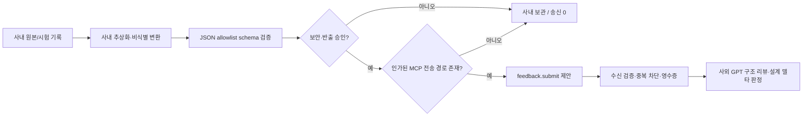

# 사내 → 사외 MCP 피드백 계약 (제안) r0001

- 제안 계약: `l1/mcp-feedback/0.1`
- 상태: `SPEC_ONLY / SERVER_NOT_IMPLEMENTED / NO_NETWORK_TEST / EXPORT_APPROVAL_NOT_GRANTED`
- 목적: 장문의 내부 변경 설명을 외부에 보내는 대신 **허용된 추상 변화 유형과 검증 상태**만 전달하고, 사외 GPT의 설계 개정 판단으로 연결한다.

## 데이터 흐름과 신뢰 경계



- MCP는 도구 호출 프로토콜일 뿐 반출 권한이나 보안 심사를 제공하지 않는다.
- 외부 MCP가 내부 네트워크에 직접 접속한다고 가정하지 않는다. **사내에서 인가된 outbound 호출**이 가능한지부터 확인하고, 불가능하면 승인된 추상 결과의 통제된 수동 반입만 별도 경로로 검토한다.
- 내부 실제 스킬 경로·제품 코드·상세 함수/MSC·Jira/P4 ID·내부 commit SHA·조직 정보·로그·고객정보·토큰·회사 비밀은 payload에 절대 넣지 않는다. 추가Properties/임의 free text를 거부한다.
- 모든 조건 실패 시 `NO_EXPORT`; GitHub PRIVATE도 외부로 취급한다.

## 제안 MCP Tool 계약 (구현되어 있다는 뜻 아님)

| Proposed tool | 호출 환경 | 의미 | 반환 |
|---|---|---|---|
| `feedback.preview` | 사내 한정 | JSON schema·허용 field·DLP/정책 검사, 외부 전송 없음 | 위반코드 + `READY_FOR_APPROVAL/REJECTED` |
| `feedback.submit` | 승인된 송신 클라이언트에서만 | 승인 객체/필드 해시·nonce와 일치한 비민감 메시지를 1회 전송 | `ACCEPTED/REJECTED/UNCERTAIN`, 메시지 영수증 ID |
| `feedback.status` | 인가된 송신 클라이언트 | 수신 영수증/중복키 조회(새 메시지 게시 없음) | `RECEIVED/REJECTED/UNKNOWN` |

### Protocol envelope

- `schema`: 고정 `l1/mcp-feedback/0.1`
- `feedback_id`: 충돌 없는 비식별 전달 ID; 실제 사내 Jira/Work ID 금지
- `handoff_revision`: 공유 가능한 설계 가이드 개정 ID (비민감)
- `subject`: `KNOWLEDGE_ROUTING | WORKFLOW_INTEGRATION | RAG_CONTRACT | REVIEW_LEDGER | MCP_TRANSPORT`
- `change_kind`: `NO_CHANGE | LOCAL_ADAPTATION | CONTRACT_GAP | PROPOSED_DESIGN_CHANGE | BLOCKED`
- `reason_code`: `ENV_CONSTRAINT | INTERFACE_MISMATCH | DUPLICATE_CAPABILITY | EVIDENCE_GAP | SECURITY_GATE | OTHER_APPROVED`
- `compatibility`: `COMPATIBLE | NEEDS_REVIEW | BREAKING_PROPOSAL | UNKNOWN`
- `test_state`: `PASS | FAIL | SKIP | NOT_RUN` (**합성/호스트/API 시험 유형 별도 field**)
- `evidence_level`: `E0 | E1 | E2 | E3`; E3라도 원본이 외부 반출 가능한 것은 아님
- `decision_requested`: `ACK | REVIEW_DELTA | REVISE_CONTRACT | CLARIFY_GATE`
- `export_approval`: `APPROVED`를 payload에 적는 것만으로 충분하지 않음; 수신측은 독립적으로 승인 receipt, actor authority, 정확한 digest, expiry, scope를 검증해야 함
- `details` 자유서술 없음; 사내 상세 근거는 연결하지 않는다.

## 엄격한 검증과 재시도

1. `feedback.preview`는 입력 타입·enum·최대 바이트·허용 방향·정책·잠재 민감 토큰을 fail-closed 검사한다. allowlist 초과/unknown fields는 REJECT.
2. **실제 승인**은 message digest + 수신대상 + 만료 + 스코프에 묶인 별도 권한 증명이어야 한다. 임의 payload 필드/서명 문자열을 모델이 만들어내 승인이라고 주장할 수 없다.
3. 전송은 `(schema, feedback_id, payload_sha256)` 기준 idempotent; 동일 ID·상이 payload는 충돌 거부. `UNCERTAIN`이면 영수증 조회 후 복구하고 임의 재호출·중복 제출 금지.
4. 수신 검증·저장·원격 readback 후에만 `RECEIVED`. 외부 도착은 사내 스킬 설치나 watcher 실행을 발생시키지 않는다.
5. 보안/DLP, outbound MCP, 수신 inbox, 승인 서명/영수증, 로깅/보존 정책이 하나라도 미확인이라면 `BLOCKED / NO_EXPORT`.

## 합성 메시지 예시

```json
{
  "schema": "l1/mcp-feedback/0.1",
  "feedback_id": "FEEDBACK-0001",
  "handoff_revision": "r0001",
  "subject": "WORKFLOW_INTEGRATION",
  "change_kind": "CONTRACT_GAP",
  "reason_code": "INTERFACE_MISMATCH",
  "compatibility": "NEEDS_REVIEW",
  "test_state": "NOT_RUN",
  "test_scope": "NONE",
  "evidence_level": "E1",
  "decision_requested": "REVISE_CONTRACT"
}
```

이 JSON은 **합성 예시**이며 승인된 전송 기록/수신 영수증이 아니다. 요청한 판단에 필요한 사실이 추상 코드만으로 부족하면 `NEEDS_CLARIFICATION` 처리하고 내부 원문을 추가 요구하지 않는다.

## 인수 기준

- 기존 MCP tool 목록/연결 방향/보안정책 우선 조사; 새 tool은 기존 기능과 중복되는지 판정.
- 외부 전송 금지 필드 포함, 미승인 상태, 재전송 충돌, expired 승인, 수신 불명, payload 바뀜, 외부 원문 데이터 포함, 자동 reviewer 트리거가 모두 안전하게 차단돼야 한다.
- `MCP_DESIGN=COMPLETE`와 `MCP_IMPLEMENTED/CONNECTED/APPROVED`를 별개 관리한다.
- 현재는 설계 문서 작성만 가능하며, 실제 사내 MCP 설치·권한·네트워크·운영 검증은 `NOT_RUN`.
