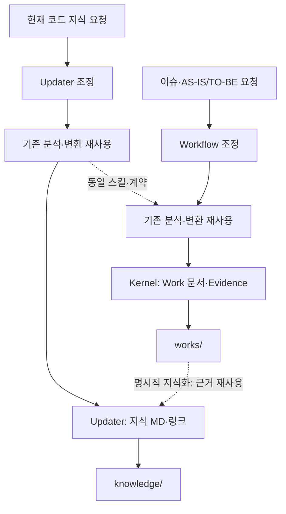

# MSC 문서의 두 독립 진입과 작성 책임 설계 r0001
- 기준: 2026-11-17 KST / 기존 Work L1-WORKSPACE-RAG-20261111-001.
- 단계: DESIGN_PROPOSAL_FOR_INDEPENDENT_REVIEW. 코드 수정·설치·업무 데이터 게시·호스트 E3는 이번 작업 범위가 아님.
- 사용자 요구: Updater 직접 UL CA 지식 작성과 Workflow 이슈 AS-IS/TO-BE 문서 작성을 서로 필수 의존으로 묶지 않으면서, 설명 MD에서 같은 모던 MSC HTML을 열람하도록 구성.
- 아래 관계는 TO-BE 책임 설계. Updater 설치본의 실제 I/O·writer·팀 지식 폴더는 G0 미확인.

## 1. 고정할 사용자 의도와 검토할 제안
고정 의도: (1) Updater 직접 지식 작성에 전체 Workflow 실행 불필요 (2) Workflow의 이슈 Work 문서 작성에 Updater 필수 호출 불필요 (3) 공통 분석·변환 기능 우선 재사용 (4) 순수 지식 작성에 Work ID 강제 금지.
검토 제안: MD별 조립 책임·호출 결과 전달·HTML opt-in·실제 게시 경로 연결. reviewer는 제안의 모순/과잉/누락을 지적하거나 더 단순한 대안을 제시할 수 있음. 의도가 실현 불가하면 근거와 충돌 조건을 명시.

## 2. 전체 관계
아래 공통 기능 노드는 동일한 기존 Code Analyzer/Converter를 각 호출자가 사용하는 의미이며, 신규 엔진이나 양쪽 자동 fan-out이 아님.

- A/B의 결과는 원 호출자와 그 입력 revision에 귀속. 공통 Converter를 쓴다는 이유로 두 저장 대상에 동시에 쓰지 않음.
- 그룹 지식 반영은 별도 Preview·유효 승인·기존 group writer/readback 단계. 개인 knowledge 저장과 그룹 게시를 합치지 않음.
- 업무용 l1-workspace와 그룹 l1sw-dev-knowledge의 실제 호스트를 동명 GitHub.com 저장소로 추측하지 않음.

## 3. 문서별 책임
| 대상 | 내용·조립 주체 | 보존/게시 주체 |
|---|---|---|
| 이슈 보고서·코드 사실 | 선택된 기존 분석기/Code Analyzer | 기존 분석 산출물·Work Evidence |
| canonical MSC 원본/상세 MSC_VIEW.md·MSC_DELTA.md·SVG/HTML | Converter: 입력 사실/설명·설계 상태를 표현. 원인/TO-BE 승인을 새로 추론하지 않음 | 원본 해시·source/analysis revision 유지 |
| Work README·문서안내·이슈 개요·논의/설계·루트 MSC_VIEW.md 안내 | Kernel: 저장된 Ledger snapshot/Evidence에서 파생 | Workflow가 기존 docs_sync/docs_push와 허용 Git writer 조정 |
| UL CA 같은 개인 지식 MD의 목차·설명 통합·절별 MSC 링크 | Updater: 실제 그룹 문서 규칙과 기존 지식 ID에 맞춰 구성 | Updater 요청의 허용 Workspace writer |
| 확정 그룹 지식 | 기존 그룹 스킬/정본의 규칙 | 기존 group writer만, 승인·readback 별도 |

두 MSC_VIEW.md는 역할이 다름: Converter의 원본 상세 문서와 Kernel의 Work 안내 문서를 구분. Kernel은 등록된 실제 상세 Evidence가 있어야 안내를 생성. 사용자 수동 문서·기존 Work 원본을 자동 덮어쓰지 않음.

## 4. 세 가지 사용 상황
### A. 현재 코드 기반 UL CA 지식 작성
Updater가 Module/Feature/Procedure·소스 범위와 불변 revision을 확인 → 기존 분석 결과의 적용성 대조 또는 필요한 범위만 Code Analyzer 분석 → Converter → 지식 MD 조립·자산/링크 저장·readback.
예시 MD 구성: UL CA 개요 / UL SCell Config 설명 + MSC 보기 / Activation 설명 + MSC 보기 / Deactivation 설명 + MSC 보기 / 제약·근거·미확인.
파일명 NR_UL_CA.md와 세 절차는 설명용 예시. 실제 메시지/코드 동작을 입증한 사례가 아님. 최종 폴더/ID는 실제 그룹 구조를 미러링하며 임의 생성하지 않음.
- Workflow를 지식 작성의 선행 관문으로 호출하지 않음.
- 순수 지식 편집/조사에 새 Work를 무조건 만들지 않음. 실제 관련 Work가 있는 경우만 기존 계약으로 연결.
- 독립 산출물 출처/revision을 Work ID 없이 보존하는 방식은 기존 Updater/그룹 계약 G0로 확인. 미확인을 신규 registry/schema 요구로 바꾸지 않음.

### B. Workflow 이슈 분석 중 AS-IS/TO-BE 요청
Workflow가 기존 Work와 유효 분석 결과를 연결. Plus 보고서/코드 근거가 유효하면 전체 분석을 중복 실행하지 않음. 필요한 코드 사실만 기존 분석기로 보강.
- AS-IS는 확인된 현재 코드 기준, TO-BE는 제안/수락/적용/시험 상태를 구별. 설계 수락을 코드 반영 PASS로 승격 금지.
- Converter가 입력된 AS-IS/TO-BE 설명·그림·비교를 만들고 Kernel 허용 방식으로 Evidence 등록.
- Kernel이 works/<Work_ID>/ 문서 묶음과 MSC 안내를 구성. Workflow가 동기화·게시 절차 조정.
- 이 경로에서 Updater나 knowledge 쓰기를 필수로 추가하지 않음. 기본은 Work 문서 묶음 + 상세 MSC 연결이며 모든 내용을 한 MD로 강제 합치지 않음.

### C. 이슈 결과의 선택적 지식화
사용자가 재사용 지식화를 요청하면 Updater가 기존 Work의 Evidence·MSC 원본·불변 source revision을 참조해 후보를 구성. Workflow 전체 재실행/새 Work 발급/동일 Code Analyzer 재분석이 기본 동작이 아님.
- 지식 쪽 origin은 기존 지원 형식만 사용, 원 Work는 보존. Work-side 역링크는 별도 기존 Kernel 계약 확인 후 기록.
- 게시 성공 후 링크만 실패하면 링크만 복구. 그룹/분석/Job 재실행 금지.
- stale revision·권한 불가·원본 해시 불일치는 HOLD/추가 확인. 갱신 필요 시 필요한 범위만 별도 판정.

## 5. HTML 출력과 문서 목적을 분리하는 최소 보완안
확인된 gap: Converter 0.2.26은 기본 view_mode=ISSUE이고 SVG 성공 + PROCEDURE_FEATURE일 때만 B HTML을 생성. Workflow MSC handoff에는 그 옵션 전달이 없음. 따라서 현 소스만으로 이슈 요청→모던 HTML 자동 연결 완료를 주장할 수 없음.

제안 A(우선 검토): 기존 Converter action에 독립적인 HTML 출력 opt-in 하나를 추가하고, ISSUE/PROCEDURE_FEATURE는 본문 목적을 계속 결정.
- 설명용 후보 이름은 --html-viewer. 새 선택 인자 제안이며 설치된 API라고 주장하지 않음. 최종 명칭·policy 변경은 리뷰 후 기존 parser/gateway 계약에 맞춰 확정.
- ISSUE + 명시 HTML opt-in: 이슈용 문제/변경/영향·AS-IS/TO-BE 설명을 유지하면서 같은 B HTML 생성.
- 기존 PROCEDURE_FEATURE 호출은 opt-in 생략 시에도 기존 HTML 동작을 유지. 기존 ISSUE 호출은 출력·기본 의미를 변경하지 않음.
- 렌더 실패 시 원본/기존 부분 상태를 유지하고 HTML 성공/깨진 링크를 만들지 않음.
- 양쪽 caller가 같은 action·출력 manifest를 소비. Workflow/Updater가 서로를 호출해서 우회하지 않음.
- 필요한 변경 후보: Converter parser/등록 action allowed_flags/실행 gateway/양쪽 caller 인자 전달·시험. Kernel 상태기계·Evidence enum·Work profile 확장은 기본안 아님.

대안 B: 기존 action/출력 계약만으로 같은 효과가 가능하다면 그것을 우선. mode 값 추가나 공통 helper 분리의 호환성·변경량을 A와 비교. 단순히 이슈를 PROCEDURE_FEATURE로 강제해 이슈 설명을 잃는 방식은 피함.

## 6. 링크·저장 책임과 실제 URL
- Converter는 로컬 원본·SVG/HTML·상세 MD와 기존 manifest를 만든다. 실제 Git 게시나 Knowledge 본문 쓰기의 최종 owner가 아님.
- 최종 writer는 실제 published_path·파일 존재·해시·독자 접근을 확인한 뒤 해당 MD의 MSC 절/링크를 확정.
- 현재 Kernel은 Evidence 복사 과정에서 파일명을 매핑하며 원본 bytes를 보존. 원본 MD의 상대 링크가 최종 게시 경로에서도 자동 유효하다고 가정 금지.
- 기존 published_path 매핑을 우선 재사용. 필요 시 원본을 변조하지 않는 파생 MSC 절/링크 표현만 기존 writer에서 생성. Converter 공통 formatter 재사용 가능성은 검토하되, 이 formatter가 Knowledge에 직접 쓰게 하지 않음.
- 자산 게시/readback 후 링크 연결. 부분 실패는 실패한 출력/연결만 보완, 분석/모델/Job 재호출 금지. 수동 본문·다른 MSC 절·원본 해시 보존.
- HTML 저장 링크와 브라우저 렌더 URL은 별개. 기존 승인 호스팅이 없으면 SVG 미리보기 + 단일 HTML 다운로드로 표시. PRIVATE 저장소만으로 Pages 접근 범위를 추정하지 않음.
- 개인용 링크를 그룹에 그대로 복사하지 않음. 신규 웹 호스팅·권한/공개 설정은 이번 설계로 승인하지 않음.

## 7. 구현·검증 경계
설계 리뷰는 문서·역할·호출 계약의 타당성을 판정. Updater/group writer G0, 실제 Kernel 등록·reader·writer, 이슈 HTML 통합, source stale/부분 실패/수동 편집 회귀는 구현 후 별도 확인.
기존 Knowledge 권한/3-way/승인·CAS·복구 설계와 개발 중 Guard는 계승하되 이번 리뷰로 재실행·승인·완료 판정을 덮어쓰지 않음.
새 Work/원장/DB/RAG 엔진·자동 watcher·운영 provider·키/토큰·호스트 설치·PUBLIC 스킬 배포는 범위 밖.
