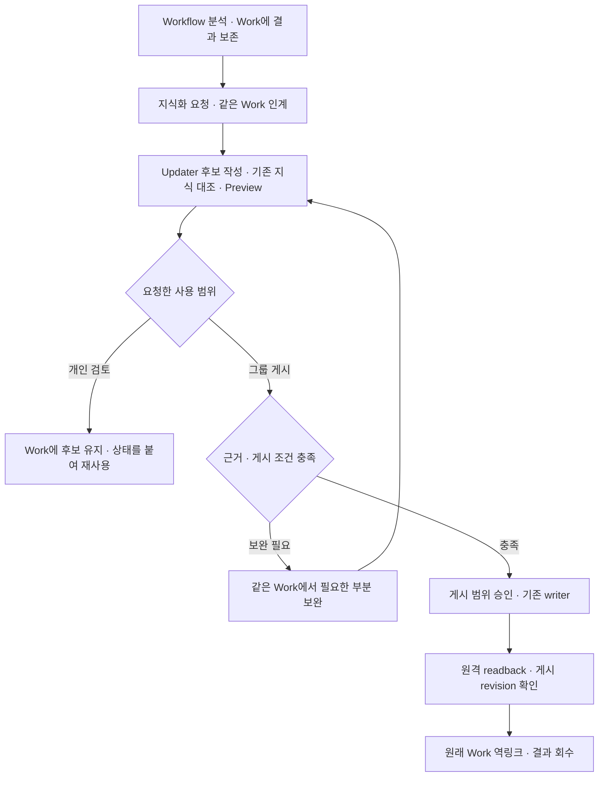

# L1 Work → Knowledge 전환 흐름과 책임 — r0001

- 작성: 2026-11-14 KST
- Work: `L1-WORKSPACE-RAG-20261111-001`
- 저장소: GitHub PRIVATE `wonhwipark/CoWork-Skill-Collab`, branch `main`
- 문서 경로: `collab/projects/L1-WORKSPACE-RAG-20261111-001/L1_WORK_TO_KNOWLEDGE_FLOW_r0001_20261114_KST.md`
- 판정: **USER_APPROVED_DESIGN / CONNECT_EXISTING_COMPONENTS**. 사용자가 대화에서 전환 흐름을 수용하고 기존 L1 지식 설계에 기록하도록 요청한 범위.
- 구현·시험: **이번 범위는 설계 문서 갱신**. 현재 설치된 Updater/Workflow의 API·필드·자동 호출·게시 성공을 확인한 결과가 아님.
- 기준: [기존 연계 계약 r0005](L1_KNOWLEDGE_UPDATER_K58_K6_WORKFLOW_CONTRACT_r0005_20261111.md) §1~3·6~9와 [11/14 피드백 판정](L1_KNOWLEDGE_FEEDBACK_DISPOSITION_r0001_20261114.md)을 유지하는 상세 흐름 보완. 기존 계약·분류표·공개 인계는 보존.

## 1. 이번에 명확히 한 결정

**분석 결과의 Workspace 저장 이후, 지식 후보 접수 → 근거·분류·기존 지식 대조 → Preview → 필요한 보완 → 승인된 게시 → 원격 확인 → 원래 Work에 결과 회수까지를 끊김 없이 연결한다.**

Workflow는 요청·Work 선택/재개와 분석 진행을 담당하고, Updater는 Work에서 재사용 가능한 지식 후보를 만들고 검토·게시 과정을 조정한다. Kernel은 Work/Evidence와 기존 기록·export의 소유권을 유지한다. 그룹 저장은 권한 있는 기존 writer를 사용한다.

Updater가 게시를 담당한다는 역할 제한을, 개인 중간 자료와 Workflow 사이의 정보 연결 금지로 해석하지 않는다. 반대로 Updater가 별도 Work 원장이나 코드 수정 실행기를 소유하는 것으로 확대하지 않는다. 여기서 “Workflow에 업데이트”는 **기존 개인 Work에 자료·결정·참조를 남겨 다음 작업이 재사용하게 한다는 뜻**이며 스킬 지침이나 코드를 매번 고친다는 의미가 아님.

사용자가 확인한 현재 단계는 NR BCH/Channel Controller, LTE ChCfg, LTE/NR Tx의 분류 검토. 분류 결과가 정상이라는 사용자 확인은 **USER_REPORTED_CLASSIFICATION_CHECKED**로 보존한다. 해당 분류를 사용한 실제 코드 분석·게시·RAG 활용은 아직 수행하지 않았다는 설명을 함께 기록한다. 이 설명을 215개 행 전체의 담당자 승인·실제 코드 지원·ID 매핑·설치/API E2E 확인으로 확대하지 않는다.

## 2. 전체 흐름

아래는 목표 책임과 분기. 노드 이름은 설명용이며 설치된 명령·API·Kernel stage/enum이 아님.

개인 검토에서 시작한 후보도 이후 같은 Work/후보 이력으로 그룹 게시 검토를 이어갈 수 있다. Work가 저장됐다는 사실만으로 그룹에 자동 게시되거나, 문서 게시만으로 분석·Job·모델 호출이 시작되는 흐름은 아님.

## 3. 단계별 동작과 사용자에게 돌아올 결과

| 단계 | 담당 | 입력과 처리 | 사용자에게 보여줄 결과 |
|---|---|---|---|
| 1. 분석 결과 보존 | Workflow → 기존 분석·변환 스킬 / Kernel | 분석 보고·Code Facts·MSC·시험/리뷰 근거를 해당 Work에 연결. 원격 저장을 수행했다면 실제 저장·조회 상태도 구분 | Work ID, 결과/근거 위치, 분석 상태, 저장 확인 여부 |
| 2. 지식화 요청 접수 | 요청을 받은 Workflow 또는 Updater | 기존 Work를 선택·재개하고 요청한 자료·목적·범위를 확인. 같은 자료를 다시 분석하거나 동일 Work를 중복 생성하지 않음 | 어느 Work·자료를 개인 후보/그룹 게시 후보로 다루는지 |
| 3. 후보 작성·대조 | Updater | 기존 Work/Artifact/Evidence를 읽어 재사용할 주장을 추림. 분류 기준·기존 지식·중복/충돌·적용 조건과 비교 | 신규/보완/중복/충돌 판정, 게시 후보 초안, 근거와 미확인 사항 |
| 4. Preview·개인 검토 | Updater / 사용자 | 후보 본문·대상·기존 내용 대비 변경·검증 범위를 제시. 개인 검토 요청이면 개인 Work에 유지 | 검토할 내용, 개인 유지/게시 검토 상태, 다음 한 조치 |
| 5. 근거 보완 | Updater가 부족 항목 인계 / Workflow가 기존 Work 재개 | 부족한 주장·필요 근거·완료 조건만 전달. 승인된 범위의 분석·자료 확인을 기존 담당 스킬로 수행 | 무엇 때문에 보완 대기인지, 담당, 필요한 결과 |
| 6. 게시 범위 승인 | 사용자 또는 기존 승인 계약의 승인 주체 | 구체 후보·대상·변경 범위·기준 revision에 연결된 기존 승인을 확인 | 승인 대상과 유효 범위. 바뀌지 않은 유효 승인을 단계마다 반복 요청하지 않음 |
| 7. 그룹 게시·원격 확인 | Updater 조정 / 권한 있는 기존 writer | 기존 충돌 보호·revision 확인·영수증/이력을 재사용해 저장하고 원격 본문·revision을 확인 | 실제 게시 위치·버전, 저장 확인 결과, 실패/불확실 상태 |
| 8. Work 결과 회수 | Updater 조정 / Kernel이 허용하는 기록 경로 | 원래 Work마다 지식 참조·고정 게시 revision·확인 결과를 연결. Work 원본 보존 | 게시 확인과 Work 연결 확인을 각각 표시한 최종 결과 |

Workflow에서 시작한 분석이 주 흐름이지만, Updater에서 코드·이슈 분석을 요청받아도 기존 Workflow/Kernel의 Work 선택·재개를 재사용한다. 순수 메모·문서 편집을 포함한 모든 요청에 새 Work를 강제하는 규칙은 추가하지 않는다.

## 4. 개인 중간 지식과 그룹 정본의 경계

| 위치/역할 | 남기는 내용 | 재사용 기준 |
|---|---|---|
| 개인 `l1-workspace`의 Work/Evidence | 원본 분석, 가설, 초안, 분류 검토, 확인된 사실과 미확인 사항, 보완 요청, 시험·결정·게시 이력 | Workflow가 같은 Work를 재개하거나 허용된 관련 작업에서 근거로 참조. 상태·출처·적용 조건을 함께 읽음 |
| 기존 개인 `module-library` | 기존 기능이 지원하는 중간 자료 탐색·연결과 그룹 미반영 후보의 보조 뷰 | 원본 Work/게시 revision을 참조. 같은 기술 내용의 독립 “최신 정본”을 두 벌 만들지 않음 |
| 그룹 `l1sw-dev-knowledge` | 검토·승인된 범위의 HLD·상세설계·AS-IS MSC·승인 설계·재사용 이슈 지식 | 주장 종류·소스/설계 기준·검증 범위·현재 적용성을 확인 |
| 게시 후 개인 Work | 원래 분석·Evidence와 그룹의 고정 게시 revision 링크 | 원본 삭제·이동 없이 계보 보존. 그룹 정정 시 변경 이력·적용성을 별도 연결 |

개인 후보는 그룹 게시 전에도 재사용 가능하지만 가설·미확정을 현재 확정 사실로 승격하지 않는다. 게시 목적과 접근 권한이 없는 다른 작업에 개인 원문이 자동 전달되는 것으로 가정하지 않는다.

Work 종료와 그룹 게시는 독립 상태. 이슈 수정이 끝나지 않아도 원인만 검증됐다면 **원인 확인 / 수정 미완료 / 시험 미실행**을 구분한 후보를 기존 정책대로 검토할 수 있다. 승인된 TO-BE는 미구현 설계로 표시하며 AS-IS 코드 사실과 구별한다.

업무용 Workspace·그룹 지식 저장소는 **업무용 Git 역할**을 가리킨다. GitHub.com의 동명 저장소로 위치를 추정하지 않는다. 이 CoWork 설계 문서에는 회사 코드·상세 MSC·로그·개인 원문을 올리지 않는다.

## 5. 최소 인계 내용 — 새 API·schema 확정 아님

다음 의미를 기존 요청·Work 참조·문서·영수증으로 전달할 수 있는지 먼저 매핑한다. 목록을 그대로 신규 필수 JSON 필드로 만들거나 Kernel record/registry에 임의 삽입하지 않는다.

| 인계 시점 | 필요한 의미 | 보존 조건 |
|---|---|---|
| Workflow → Updater | 실제 Work 식별자/위치와 기준 revision, 요청 범위·개인 검토/게시 의도, 원본 Artifact/Evidence 참조 | 동일 Work 재사용. 복수 Work 근거는 각각의 출처 보존 |
| 후보의 근거 | 생산 스킬·버전·실행 결과, Git 고정 SHA 또는 P4 파일 revision 등 기존 소스 기준, 설계 revision, 주장별 검증 상태 | 코드 사실·설계·런타임 관측을 구별. 없는 근거를 만들어 채우지 않음 |
| 후보의 분류·대상 | 기존 Module → Feature → Scenario 및 Procedure/Feature 검토 기준, 기존 지식 ID/대상 위치, 신규/보완 판정 | 분류 검토행 ID를 실제 지식/Work ID로 전용하지 않음. 215행과 33개 상위 후보 자동 병합 금지 |
| Updater → Workflow 보완 | 부족한 주장, 필요한 확인/산출물, 기존 근거, 완료 조건, 원래 Work/후보 참조 | 필요한 범위만 재개. 실행 권한 없는 요청은 보완 대기로 남김 |
| Updater → 게시/Work 결과 회수 | 승인된 후보·대상·변경/기준 revision, 실제 게시 revision·readback, Work별 연결 상태 | 게시 성공과 연결 성공 별도. 기존 writer/Kernel 소유권 유지 |

실제 함수·명령·저장 필드·stage는 업무 GPT가 보유한 기존 결과와 설치 계약을 대조해 확인할 항목. 미확인은 기능 부재가 아니며 새 adapter·원장·DB·동기화 엔진을 먼저 만들 이유가 아님.

## 6. 보완·게시·중단 뒤 재개 규칙

- **보완:** Updater가 부족한 근거를 정리하고 Workflow가 기존 Work에서 필요한 부분을 수행. 원인·분류·Preview만으로 code-fix 또는 유료 모델을 자동 호출하지 않음. 이미 승인된 실행 범위는 재사용하고 범위를 벗어난 동작만 별도로 판단.
- **재사용:** 같은 Work·입력 revision·scope에서 유효한 분석은 다시 돌리지 않음. 입력이나 후보 본문이 달라지면 적용성·승인 유효성을 재평가.
- **충돌:** 기존 지식 revision이 바뀌면 최신 본문을 비교하고 Preview를 갱신. 변경 전 승인을 변경 후 본문에 그대로 적용하지 않음.
- **응답 유실:** 저장 성공 여부가 불확실하면 기존 commit·이력·영수증·readback으로 정산. 임의 재게시 금지. 권위 있는 미저장 확인과 유효한 조건이 있어야 기존 계약의 통제된 재시도 가능.
- **역링크 실패:** 그룹 게시 확인과 Work 연결 실패를 각각 남기고 연결만 복구. 링크 실패 때문에 그룹 본문을 중복 게시하지 않음.
- **개인 유지·보류·취소:** 개인 후보와 원본 근거를 보존하고 상태를 남김. 보류를 실패나 자동 재실행 예약으로 해석하지 않음.

이 절은 기존 r0005 §8의 설명을 단계에 연결한 것. 새 CAS·영수증·복구 엔진 도입 결정이 아님.

## 7. 사용자에게 보여줄 진행 상태

아래는 **표시 의미**. 설치된 Kernel stage/enum·신규 데이터 모델로 확정하지 않는다. 기존 상태·문서/영수증에서 파생하고, 지원 여부가 미확인이면 설명형 결과로 제시한다.

| 표시 축 | 예시 상태 | 함께 보여줄 내용 |
|---|---|---|
| 분석·저장 | 분석 중 / 분석 저장 확인 / 결과 확인 필요 | Work, 결과 위치, source 기준 |
| 지식 후보 | 접수 / 후보 작성 / 개인 검토 / 보완 필요 / 게시 검토 / 보류 | 후보 요약, 부족 근거, 현재 담당, 다음 조치 |
| 그룹 게시 | 미요청 / 승인 대기 / 게시 중 / 원격 확인 / 충돌 / 결과 확인 필요 | 대상, 승인 범위, 게시 revision·확인 근거 |
| Work 연결 | 미연결 / 일부 연결 / 연결 확인 | 원본 Work별 지식 참조, 실패 위치 |
| 검색·RAG 활용 | 별도 미실행 / 별도 검증 필요 / 해당 사례 확인 | 실제 회수 본문과 Provider 입력 확인 근거 |

게시 readback이 확인됐지만 역링크가 실패했다면 “게시 확인 / Work 연결 대기”라고 보여준다. 분석 저장이나 게시 확인만으로 RAG 활용까지 완료 표시하지 않는다.

가상 표시 예: **“NR TX 분석 저장 확인 · 개인 지식 후보 검토 중 · 보완할 근거: 적용 소스 범위 · 다음: 같은 Work에서 범위 확인”**. 실제 실행 결과가 아닌 화면/응답 의미 예시.

## 8. 현재 설계 확인과 첫 실제 분석 검증의 분리

| 항목 | 이번 상태 | 완료를 확인할 시점/근거 |
|---|---|---|
| 개인 Work → 후보 → 보완 → 승인 게시 → 결과 회수의 책임·인계 | 사용자 수용에 따라 문서화 | 이 문서·CURRENT·브리프의 연결 및 정적 정합성 |
| 모듈 분류 의미 확인 | USER_REPORTED_CLASSIFICATION_CHECKED | 사용자 확인을 보존. 코드 지원/담당자 전체 승인으로 확대하지 않음 |
| Updater/Workflow 설치 API·기록·재개 연결 | NOT_VERIFIED | 이미 보유한 업무 GPT/G0 결과와 실제 계약 매핑. 전체 조사 반복 금지 |
| 실제 Work 저장·지식 후보 입력·게시·역링크 | NOT_RUN / NOT_VERIFIED | 첫 승인된 실제 분석에서 단계별 결과·영수증·원격 확인 |
| 실제 검색 본문 회수·Provider 입력 | NOT_RUN / 기존 RAG M1 게이트 유지 | 게시/링크 확인과 별도로 실제 본문 소비 근거 확인 |
| 새 독립 리뷰·호스트 시험·스킬 설치/배포 | NOT_RUN | 이번 설계 수용과 별개. 기존 CL/PR 리뷰 상태를 이 문서의 리뷰로 소급하지 않음 |

첫 실제 분석이 없다는 사실을 현재 분류 설계의 결함으로 판정하지 않는다. 다만 해당 실행을 완료했다고 보고할 때는 그 단계의 근거가 필요하다. Updater v1.8·검사 485 PASS 등 첨부에서 언급한 보고를 이번 설계 문서 작성만으로 재검증한 것으로 기록하지 않는다.

### 첫 사례에서 확인할 분기 — 시험 계획, 모두 NOT_RUN

1. 기존 Work 하나를 선택해 재분석 없이 후보를 만들고 원본 근거·분류·적용 범위가 보존되는지 확인.
2. 개인 검토로 유지한 후보를 Workflow가 상태와 출처를 포함해 다시 참조하는지 확인.
3. 근거 보완이 같은 Work의 필요한 항목만 재개하고 중복 Work/후보·분석을 만들지 않는지 확인.
4. 승인 범위·대상 revision 변경 시 Preview/승인 조건을 재평가하는지 확인.
5. 게시 readback과 Work 역링크 결과를 분리하고, 연결 실패 시 그룹 재게시 없이 연결만 복구하는지 확인.
6. 게시 응답 유실을 기존 이력으로 정산하며 불확실 상태를 완료/미저장으로 단정하지 않는지 확인.
7. 검색·본문 회수·Provider 입력의 실제 활용을 게시 성공과 분리해 확인.

## 9. 기존 구성에 대한 판정과 다음 한 동작

| 판정 | 적용 |
|---|---|
| REUSE | Workflow Work 검색·재개, Kernel Work/Evidence/허용 기록, 기존 analyzer·converter, Updater 분류·중복/충돌·Preview·승인, 기존 그룹 writer·SCM/영수증 |
| CONNECT | 동일 Work의 자료를 후보 입력에 연결하고, 부족 근거를 Work로 반환하며, 게시 revision·확인 결과를 원래 Work에서 조회 |
| 최소 EXTEND | 위 연결이 기존 기능으로 충족되지 않는다는 실제 GAP이 확인될 때만 변경 파일·호환·검증 범위를 별도로 확정 |
| DEFER | 새 Work 원장, 별도 지식 스킬/RAG 엔진/DB/schema, 자동 동기화·백그라운드 감시의 선행 도입 |

**다음 한 동작:** 업무 GPT가 이미 보유한 결과를 사용해 “기존 Work 선택 → Updater 후보 입력 → 보완 결과 재접수 → 게시/역링크 결과 반환”의 실제 진입점·기록·조회 기능을 매핑하고, 확인된 연결/미확인/실제 GAP만 구분. 현재 분류 검토를 다시 수행하거나 새 코드 분석·Job·게시를 자동 시작하는 지시가 아님.

## 10. 근거와 변경 경계

| 근거 | 확인 기준 blob / 의미 |
|---|---|
| 기존 연계 계약 r0005 | `9a8339abd493afa4119445228a843e95ad1f8f8f` / 책임·개인/그룹·논리 인계·게시·복구·RAG 경계 |
| 2026-11-14 피드백 판정 | `16b522a61be3c8c4257d42491ad0f22679de053b` / G0 일부 보고, 현재 설계와 첫 분석 후속 분리 |
| 스킬 카탈로그 | `483d62e2ad95ae074ab9119f2ec591331975639f` / 기존 역할 매핑. 현재 호스트 API PASS 목록 아님 |
| 사용자 이번 대화 | 분류 확인·실제 코드 분석 미실행 설명, 개인 중간 지식 재사용 요구, 이 흐름의 설계 반영 지시 |

이번 변경은 이 설계와 연결된 PRIVATE 문서·기존 Tracker의 다음 조치만 갱신. 운영 Work/Evidence·Knowledge·metadata·소스/스킬·DB·Job·watcher·LIVE 변경이나 PUBLIC 게시를 수행하는 범위가 아님. 기존 CL/PR 후보·시험·배포 상태는 별도로 보존한다.

설계 반영과 문서 QA, 원격 게시/readback, 실제 스킬 구현/시험을 구분한다. 게시 검증 기록은 [이 흐름의 게시 확인 문서](L1_WORK_TO_KNOWLEDGE_FLOW_PUBLICATION_RECEIPT_20261114_KST.md)에서 확인.
