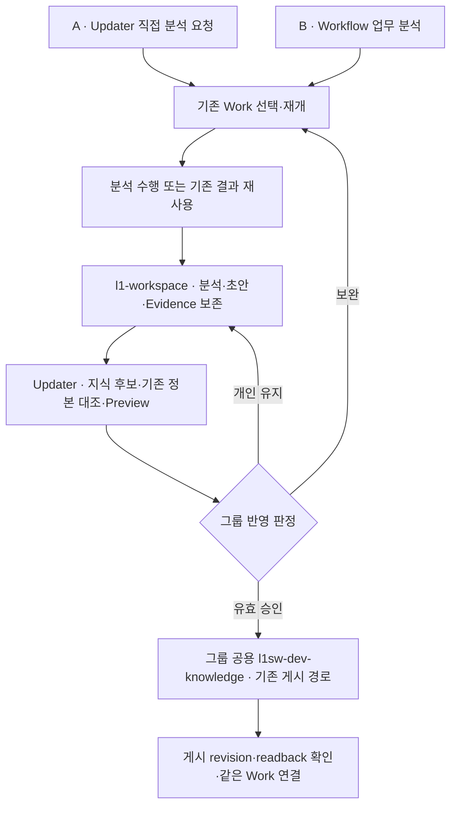

# L1 분석 → Workspace 보존 → 그룹 지식 반영 흐름과 책임 — r0002

- 개정: 2026-11-15 KST / Work: `L1-WORKSPACE-RAG-20261111-001`
- 정본: GitHub PRIVATE `wonhwipark/CoWork-Skill-Collab`, branch `main`
- 판정: 사용자 피드백 **수용**. Updater가 수행·조정한 분석도 개인 업무용 Workspace에 보존하는 설계 요구를 명확히 함.
- 기반: [r0001](L1_WORK_TO_KNOWLEDGE_FLOW_r0001_20261114_KST.md)의 승인·중복/충돌·복구·역링크·RAG 경계를 유지. 두 진입 경로와 분석 저장 책임은 이번 개정을 우선 적용.
- 실제 Updater 구현·호스트 API·Workspace 저장/readback·그룹 게시 E2E: **NOT_VERIFIED / NOT_RUN**. 문서 반영을 기능 구현 완료로 해석하지 않음.

## 1. 사용자 결정과 저장 책임

`l1-knowledge-updater`에서 직접 분석한 내용도 **개인 업무용 `l1-workspace`의 Work에 올릴 수 있어야 함**. `l1sw-dev-knowledge`는 그룹 공용 스킬이므로, 그룹 반영 여부와 별개로 개인 분석·검토·보완 이력을 이어갈 수 있어야 함.

따라서 Workspace 보존은 게시 판정에서 ‘개인 유지’를 선택했을 때만 생기는 경로가 아님. 두 진입 경로 모두 원본 분석·초안·근거·미확인·결정을 같은 Work에 보존하고, 재사용 가능한 내용을 그룹 반영 후보로 선별. 그룹에 반영한 후에도 Work의 원본은 보존하고 실제 그룹 게시 revision을 연결.

| 진입 | 수행·조정하는 내용 | Workspace에 남길 내용 | 그룹 반영 |
|---|---|---|---|
| A. Updater 직접 요청 | Module의 Procedure/Feature 기반 코드 조사·지식 정리. 필요한 기존 analyzer/converter와 연결 | Updater의 분석 결과·초안·source revision·Evidence·검토/보완 이력을 같은 Work에 저장 | 검증·승인된 재사용 지식만 그룹 공용 스킬의 기존 게시 경로로 반영 |
| B. Workflow 업무 결과 | 기존 Workflow의 코드/이슈 분석·수정/시험·설계 결과를 지식화 | 이미 보존한 Work/Evidence를 재사용. Updater가 만든 후보·검토·결정만 같은 Work에 추가 연결 | 동일한 후보 대조·Preview·승인·게시/readback 경로 적용 |

A에서 받은 요청도 기존 Work 검색·재개를 우선 사용. 실제 분석 작업에 맞는 Work가 없을 때 기존 생성 계약을 적용하며, 순수 조회·메모까지 새 Work를 강제하지 않음. B에서 이미 유효한 분석을 지식화 때문에 다시 실행하지 않음.

## 2. 두 진입이 합류하는 흐름

아래 화살표는 목표 책임·자료 전달 관계이며, 설치된 명령·API·자동 호출을 뜻하지 않음.

Updater는 분석 요청·후보·검토/게시 과정을 조정하고, Work/Evidence 기록은 Workflow/Kernel의 허용된 기존 경로로 연결. 이 설계로 Updater 전용 원장·별도 Git writer·새 동기화 엔진을 추가하지 않음. 실제 함수와 권한 매핑은 업무 호스트에서 확인할 항목.

## 3. 역할과 정본

| 대상 | 역할 | 반드시 구분할 점 |
|---|---|---|
| `l1-knowledge-updater` | 업무 GPT에서 만든 분석·지식 업데이트 연동 스킬. 직접 분석 요청과 기존 Work 지식화 요청을 모두 접수하는 설계 | 사용자 설명과 설계 요구이며 실제 설치본의 연결 기능은 미검증 |
| 업무용 개인 PRIVATE `l1-workspace` | 분석·가설·초안·근거·미확인·결정·보완·시험/리뷰 이력의 Work 정본 | 그룹 게시의 선행/후행 결과를 같은 Work에서 추적. 동명 GitHub.com 저장소로 위치 추정 금지 |
| 그룹 공용 `l1sw-dev-knowledge` | 팀이 사용하는 스킬과 그 스킬이 관리하는 검증된 기술 지식 정본 | 스킬과 저장소를 동일시하지 않음. 실제 저장 위치·writer·권한은 설치 계약으로 확인 |

상세 HLD·상세설계·AS-IS MSC·재사용 가능한 이슈 지식도 검증·승인 범위에서 그룹에 포함 가능. 개인/그룹 구분은 문서 상세도로 결정하지 않음. 같은 분석이 두 위치에 연결될 수 있으나, 분석·판정 이력의 정본은 Work, 승인된 공유 지식의 정본은 그룹의 고정 revision으로 구분.

## 4. 저장·게시 결과와 실패 처리

- **Workspace 저장:** 두 진입 모두 Work ID·분석/초안 위치·source revision·근거·미확인·생산 스킬/실행 결과·저장 확인 여부를 기존 기록으로 남김. 성공은 실제 commit/revision과 원격 readback으로 확인.
- **그룹 반영:** 필요한 후보만 기존 지식과 대조·Preview하고 유효 승인·대상 revision·권한을 확인. Workspace 저장 자체를 그룹 게시 승인으로 사용하지 않음.
- **그룹 보류·실패:** Workspace 분석·근거를 보존하고 그룹 미반영 이유·다음 조치만 갱신. 그룹 실패 때문에 분석을 다시 실행하지 않음.
- **Workspace 저장 실패·불확실:** 해당 단계만 실패/확인 필요로 보고하고 산출물·기존 이력으로 정산. 그룹 게시 성공을 개인 저장 성공으로 대신 표시하지 않음.
- **게시 후 Work 연결 실패:** 그룹 게시 revision과 연결 실패를 구분하고 연결만 복구. 링크 실패로 그룹 재게시 금지.

기존 Work ID·Source Revision·Artifact/Evidence·게시 영수증을 우선 재사용. 설명 항목을 새 필수 필드·enum·schema로 확정하지 않음.

## 5. 확인 상태와 다음 한 동작

| 항목 | 상태 | 다음 근거 |
|---|---|---|
| 두 진입 모두 Workspace 분석 저장 + 검증 지식의 그룹 반영 설계 | 사용자 피드백 수용·문서화 | 본 r0002·CURRENT·브리프·카탈로그 연결 |
| 대시보드 표현 | 같은 13단계에 두 진입과 개인/그룹 책임을 명시하는 변경 범위 | 대시보드 CURRENT와 실제 결과에서 별도 확인 |
| Updater 분석 → 개인 Workspace 실제 저장/readback | NOT_VERIFIED / NOT_RUN | 업무 GPT가 가진 최신 설치 원문·기존 결과로 실제 진입점/기록/권한 매핑 |
| 기존 Workflow Work → Updater → 같은 Work에 검토 결과 추가 | NOT_VERIFIED / NOT_RUN | 기존 Work·분석 재실행/중복 생성 없이 저장·재조회 확인 |
| 그룹 미반영 시 개인 결과 보존, 승인 게시 후 revision 연결 | NOT_RUN | 첫 승인된 실제 사례의 단계별 결과·영수증 |

**다음 한 동작:** 업무 GPT가 기존 결과와 설치본을 사용해 두 진입 각각의 Work 선택·분석 기록·Workspace 저장/readback·그룹 게시·결과 회수 경로를 매핑하고 REUSE/CONNECT/미확인/입증된 GAP만 회신. 실제 코드 분석·설치·그룹 쓰기·Job을 이번 문서로 시작하지 않음.

기존 독립 리뷰의 고정 r0001 REQUEST/ZIP/manifest/SOURCE_PIN은 보존. r0002는 그 고정 입력에 포함되지 않은 후속 보완이며 기존 리뷰의 검토/승인 결과를 소급 적용하지 않음. 신규 유료 리뷰·운영 변경 없음.
