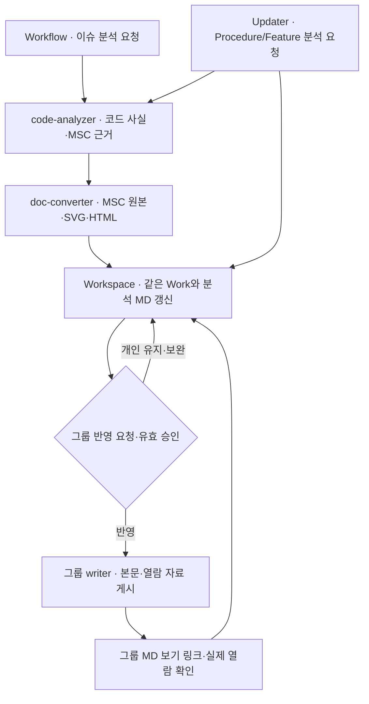

# Procedure/Feature MD의 MSC 보기 링크 — 스킬 지원 검토·제안 — r0001

- 기준: 2026-11-15 KST / 기존 Work `L1-WORKSPACE-RAG-20261111-001`
- 요청: Workflow/Updater에서 code-analyzer로 분석하고 doc-converter로 만든 MSC를 Workspace 또는 그룹 지식에 반영할 때, 해당 Procedure/Feature MD에 샘플과 같은 미리보기·HTML 보기 링크를 연결.
- 판정: **요구 수용 / 기존 기능 재사용·연결 / 아래 확인한 공개 baseline의 표시·게시 공백만 최소 보완 제안**.
- 명칭: `dac-converter`는 `doc-converter`로 해석. `l1-fix-analyzer`라는 정본 이름은 현재 관리 목록에서 미확인; 대화의 기존 `l1-fix-workflow`를 기준으로 검토. 이슈 분석 진입의 `issue-analyzer`는 별도 기존 스킬로 구분.
- 범위: 4개 공개 패키지의 문서·관련 구현 정적 검토와 실제 공개 UI 샘플 근거. 업무 GPT의 `l1-knowledge-updater`·그룹 `l1sw-dev-knowledge` 설치 원문/실제 writer·호스팅·저장 E2E는 미접근·미검증. 이번에 스킬 코드·패키지·설치·업무 지식·PUBLIC 파일·Job·새 유료 리뷰를 변경/실행하지 않음.

## 1. 결론과 두 진입 경로

**작성한 MSC를 해당 Procedure/Feature 본문에서 바로 열게 하는 지원이 목표. MD 안에 미리보기와 ‘MSC 확대 보기’를 넣고, HTML 안에서 같은 MSC의 SVG를 읽게 함.**

두 진입은 `l1-fix-workflow → code-analyzer`와 `l1-knowledge-updater → code-analyzer`. 두 스킬 모두 같은 Work에 자기 분석·초안·근거·표현 산출물·결정을 저장/갱신하는 주체. Updater의 저장에 전체 Workflow 실행을 의무화하지 않고, 기존 Kernel/허용 writer를 공통 재사용.

그룹 반영을 요청한 경우 Updater가 검증 지식·변경 범위를 대조하고 기존 그룹 스킬/writer의 유효 승인·게시 경로를 사용. Workspace 분석 원본과 이력은 유지하고 실제 그룹 게시 revision을 연결. 그룹 문서에 개인 Workspace의 비공개 뷰어 URL만 복사하는 방식은 기본 해법이 아님.



화살표는 목표 책임·자료 전달 관계이며 설치·자동 호출·게시 성공을 뜻하지 않음.

## 2. 실제 원문에서 확인한 재사용 기능

| 구성 | 확인한 공개 baseline / 원문 근거 | 재사용할 부분 |
|---|---|---|
| code-analyzer | v0.15.2, SKILL의 procedure 단위 출력·HLD marker·msc_ref, references/phase_f.md | 확인된 코드 사실·source revision·근거, Procedure MSC/PUML, 기존 분석 재사용·변경 시 재생성 |
| doc-converter | v0.2.21, scripts/msc_tool.py::msc_view_text / cmd_package | 기존 semantic/verified scenario 입력, PUML·실제 SVG·MSC_VIEW.md·추적·게시용 manifest |
| doc-converter | policy의 msc-render / msc-package / msc-scenario-adapt / msc-scenario-build | 기존 등록 action·renderer/style 검증. 일반 MD→HTML과 msc-export도 존재하므로 ‘HTML 변환 기능 자체 없음’으로 판단하지 않음 |
| l1-fix-workflow | v1.6.67, scenario_msc.py::build_msc_handoff | code-analyzer 사실 권위, verified scenario IR, converter·Kernel 소유권을 구분한 인계 |
| l1-fix-workflow | msc_view.py::view_work_msc | 등록된 정확한 Work의 원본을 해시 확인해 읽는 조회. 현재 이 조회는 텍스트 Scenario Flow이며 웹 뷰어 게시 기능으로 보지 않음 |
| Kernel | v0.7.37, generated_doc_registry.py / work_docs_navigation.py | MSC_VIEW.md 안내·수동 문서 충돌 보호·기존 export |
| Kernel | work_ux.py::export_docs | 등록 Evidence의 게시 경로/해시 매핑, 실제 MSC_VIEW 산출물의 Work 안내 연결 |
| Updater / 그룹 지식 스킬 | 현재 CURRENT·r0002 설계·기존 B 인계서 | 개인 결과 보존·그룹 후보/Preview·유효 승인/기존 writer 연결이라는 요구·역할. 설치 API의 실제 지원 증거로 승격하지 않음 |

code-analyzer는 이미 내장 MSC 표현 정책과 결정형 출력이 있음. 기존 `msc_ref`/PUML을 버리거나 모든 분석을 변환 때문에 다시 돌리지 않음. 생성 근거가 맞는 기존 결과를 우선 재사용하고, doc-converter가 승인된 표현/뷰어 묶음을 담당하도록 연결.

## 3. 확인된 공백과 주의할 연결 지점

### F1. B형 HTML 뷰어는 기본 MSC package 출력에 연결돼 있지 않음
확인한 converter baseline의 기본 묶음은 PUML·SVG·검증·MSC_VIEW.md·manifest 등. `msc_view_text()`는 MD의 SVG 이미지 링크와 원본/추적 링크를 만들지만 샘플의 확대·스크롤·단계 이동 HTML 뷰어 링크까지 생성하지 않음.

**제안:** 일반 HTML 변환·기존 MSC package/템플릿을 재사용해 B 열람 산출물을 converter에 최소 보완. 샘플의 고정 1200×1950/단계 y 좌표를 생산 기능에 복사하지 않고 실제 SVG viewBox·입력 Phase/step·기존 추적 자료에서 계산. 단계 근거가 없으면 확대·스크롤만 제공하고 가상 단계를 만들지 않음.

### F2. Work export의 그림·파일 경로 전달을 확인해야 함
확인한 Kernel `work_ux.py`의 small Evidence 복사 조건은 `.md/.html/.json/.txt`이고 `.svg/.puml`은 그 복사 조건에 없음. 또한 개별 파일을 category/안정적 Evidence 이름으로 게시하므로 converter MD의 원래 상대 SVG 경로를 그대로 사용할 수 있다고 가정하지 않음.

**제안:** 우선 기존 Git/게시 writer가 승인된 그림 묶음을 보존하는지 확인해 재사용. MD의 링크는 기존 게시 경로 매핑으로 생성. 자체 내장 SVG HTML은 보조 이미지 의존을 줄이지만 등록·크기 상한·호스팅은 별도 확인. 기존 경로로 충족 불가할 때만 export의 허용된 파생 파일/묶음 처리와 링크 투영을 최소 확장. 모든 확장자를 무제한 허용하거나 새 Evidence 종류를 추정 삽입하지 않음.

원본 Evidence를 다른 경로로 복사한 뒤 본문을 몰래 고쳐 해시 의미를 바꾸지 않음. 필요한 링크 투영은 기존 문서 생성/허용된 파생 산출물 경로를 사용하고 원본·게시본 관계를 보존.

### F3. 생성 완료와 이미지·웹 열람 완료는 다름
Workflow MSC handoff에 `allow_unrendered=True`가 있고 converter도 미렌더 PUML fallback을 지원. 이것은 기존 원본 보존 경로로 유지하되, SVG·HTML이 없는 상태에서 ‘MSC 확대 보기’를 완료 링크로 생성하면 안 됨. 기존 manifest는 remote/browser 확인을 기본 false로 구분함.

**제안:** 실제 SVG 생성·유효한 HTML·게시 readback·브라우저 표시를 각각 확인. 렌더 실패 시 원본/분석은 보존하고 그림 미완료로 표시. 파일 소스/blob URL을 렌더링 URL로 오인하지 않음.

### F4. Registry·그룹 writer 계약은 설치본에 매핑해야 함
확인한 Kernel registry의 analyze/asis_msc slot에는 code-analyzer가 등록돼 있고 converter 산출물을 어떤 허용 경로로 기록할지는 실제 producer/Artifact 계약 매핑이 필요. renderer를 분석 사실 생산자로 위장하거나 임의 provider/kind를 추가하지 않음.

또한 Workflow baseline의 `group-knowledge`는 읽기 전용 bridge임. 이를 실제 그룹 지식 쓰기 기능으로 취급하지 않고 Updater/그룹 스킬의 기존 writer·승인 경로에 연결해야 함.

### F5. 그룹 문서의 뷰어도 그룹 독자가 열 수 있어야 함
팀 문서에 개인 Work의 비공개 이미지·HTML URL을 넣으면 본문은 열려도 그림은 열리지 않을 수 있음.

**제안:** 승인한 그룹 본문과 필요한 열람 자료를 팀이 접근할 수 있는 기존 위치에 게시하고, 그룹용 최종 URL/그림 상대 경로를 산출. 원본 Work 링크는 별도 추적 링크. HTML·SVG·설명·원본·추적 자료의 게시 허용 범위를 같이 검토. `MSC_PUBLIC_MANIFEST.json`이라는 파일명은 PUBLIC 게시 승인이 아님.

## 4. 스킬별 지원 제안

| 대상 | 지원할 책임 | 변경 범위 판단 |
|---|---|---|
| l1-fix-workflow | 기존 Work 선택·재개 → 필요한 분석/변환 연결 → 생성된 자료와 본문 보기 링크를 같은 Workspace Work로 회수 | 기존 인계·Work 기록 재사용. 새 HTML 렌더러·별도 지식 writer를 Workflow에 만들지 않음 |
| l1-knowledge-updater | 직접 분석 또는 기존 Work 수신, 같은 converter 재사용, 개인 결과 갱신, Procedure/Feature 대상 선택·후보/Preview·그룹 반영 조정 | 업무 GPT의 설치 원문에서 실제 I/O·writer를 확인 후 기존 기능 연결. 전체 Workflow 재실행 강제 없음 |
| code-analyzer | 검증된 사실·원본 MSC/구조·source revision·근거 제공, 기존 Procedure/Feature 본문 마커·msc_ref 보존 | 뷰어 때문에 재분석하지 않음. 사실 확인·변경된 분석이 필요한 경우만 기존 분석 경로 사용 |
| doc-converter | 동일 입력의 원본·SVG·B HTML·선택적 미리보기와 기존 manifest/추적을 연결. Procedure/Feature용 표시 절의 공통 표현 제공 | 가장 명확한 표시 보완 후보. 이슈가 아닌 분석에는 ‘문제/수정’만 강요하지 않고 목적·트리거·흐름·결과·한계 중심으로 표시 |
| work-ledger-kernel | 허용된 Work/Artifact/Evidence·게시 경로·문서 안내·수동 수정 보호·결과 연결 | 기존 경로 매핑 재사용; F2/F4의 실제 미충족 부분만 최소 보완. 새 원장/schema 없음 |
| l1sw-dev-knowledge | 승인된 지식 본문과 필요한 열람 자료를 그룹 계약으로 수용하고 해당 Procedure/Feature MD의 MSC 절 갱신 | 그룹 설치 원문/실제 저장 위치·권한 미확인. 별도 GitHub.com 저장소를 추정하지 않음 |
| 기존 Git/호스팅 제공자 | 권한 있는 대상의 파일 저장·commit/revision/readback, 실제 HTML 열람 주소와 접근 확인 | 기존 승인 경로 우선. 회사 분석을 PUBLIC 샘플 경로로 전달하지 않음 |
| issue-analyzer (이슈 진입일 때) | 증상·원인·해결·수정 방향 승인과 필요한 focused MSC 요청 | 기존 코드 사실/표현 스킬에 위임. 수정 방향 승인을 code-analyzer/converter가 대신 만들지 않음 |

반영 대상은 **Procedure/Feature 지식·분석 본문과 산출물**. 매 분석마다 SKILL.md 코드를 고치는 운영이 아님.

### 링크 작성의 소유권
converter는 같은 MSC를 보여주는 자료와 표시 내용을 만들고, **대상 문서의 기존 작성/게시 경로가 실제 게시 위치에 맞는 링크를 삽입**. Workspace 문서는 Workflow/Updater가 Kernel·허용 writer와 연결하고, 그룹 문서는 Updater가 그룹 스킬/writer와 연결. 두 진입 스킬이 서로 다른 뷰어 템플릿을 만들지 않음.

## 5. Procedure/Feature MD의 권장 표시

아래는 설명용 예시이며 신규 필수 schema/명령이 아님. 실제 문서명·Scenario ID·생성 파일명을 재사용.

```markdown
## MSC

- 구분: AS-IS / TO-BE 등 실제 분석 구분
- 시나리오·분석 기준: 확인한 Scenario와 source revision
- 확인 수준: 코드 확인 / 설계 승인 / 미확인 등을 실제 근거대로 표시

[MSC 확대 보기](대상_독자가_열_수_있는_HTML_URL)
[MSC 원본](실제로_게시된_원본_경로)

```

한 Procedure/Feature에 MSC가 여러 개면 기존 본문의 시나리오 표로 연결. `module→feature→scenario` 탐색과 Procedure/Feature 교차 분류를 유지하고 별도 중복 지식 트리를 만들지 않음. 아직 확정되지 않은 분류 검토행 ID를 실제 지식 ID로 전용하지 않음.

기존 생성 마커/본문 보호를 재사용해 해당 MSC 절만 갱신. 사람의 설명·다른 Procedure·기존 근거를 덮어쓰지 않음. 같은 입력의 재게시에서 링크를 중복 append하지 않음. 자동 관리 마커가 없으면 기존 writer의 Preview/diff·충돌 처리를 우선 확인.

## 6. 게시 순서·부분 실패·재사용

1. 기존 Work와 source/분석 revision·대상 Procedure/Feature를 확인하고 유효한 분석을 재사용.
2. 기존 action/검증된 IR로 MSC를 생성·변환. 원본·SVG·HTML을 같은 입력으로 연결.
3. 대상 독자·실제 호스팅·게시 경로 매핑을 확인하고 본문 링크·그림·HTML·필요 원본의 변경 Preview를 준비.
4. 유효한 기존 승인 범위에서 기존 writer로 게시. 한 commit으로 가능한 묶음은 기존 방식 사용; 그렇지 않으면 자료를 먼저 확인하고 MD 보기 링크를 마지막에 연결.
5. 본문·자료의 원격 revision/readback과 실제 렌더링 페이지의 그림 표시를 확인.
6. 원래 Work에 결과·게시 revision·연결 상태 회수.

- Workspace 보존과 그룹 게시 성공을 별도 판정. 그룹 보류/실패에도 개인 분석·초안·근거 보존.
- 그룹 게시 뒤 Work 링크만 실패하면 링크만 복구. 분석·렌더·그룹 게시 전체를 재실행하지 않음.
- 단순 링크/양식 변경은 분석 재실행 사유가 아님. 근거·source 변경 시에만 기존 refresh 판단 적용.
- MSC가 불필요/보류인 요청에는 기존 NO_MSC_REQUIRED/HOLD 정책 유지. 빈 보기 링크나 가상 MSC를 만들어 채우지 않음.
- 사람은 HTML로 열람하고 분석 스킬은 MD·MSC 원본/구조·근거를 재사용. 링크/페이지 표시만으로 RAG 본문 소비 PASS를 선언하지 않음.

## 7. 권장 적용 순서와 완료 기준

1. **설치 계약 좁은 확인:** Updater·그룹 스킬 원문, 현재 converter/Kernel 버전·writer·HTML 접근/호스팅, 실제 Work 하나의 경로를 기존 보고로 대조. 공개 baseline과 설치본 차이는 확인된 것만 기록.
2. **converter 우선:** 기존 MSC package에 입력 기반 B HTML/미리보기·표시 내용을 연결하는 최소 보완 후보 확정. generic HTML 변환과 기존 SVG/manifest를 재사용.
3. **게시·본문 연결:** 기존 Work/그룹 writer의 경로 매핑·그림 묶음과 해당 MD 절 갱신을 연결. 현재 exporter로 부족할 때만 좁은 확장.
4. **두 진입 연결:** Workflow/Updater가 같은 출력·상태를 회수하고 Workspace 저장과 그룹 게시를 요청 범위로 분기.
5. **한 사례 검증:** 공개 가상 입력으로 자동 생성·링크/게시 회귀를 먼저 검증하고, 업무 호스트에서 승인된 실제 Scenario 하나로 저장·열람을 검증.

최소 검증은 두 진입 × Workspace 저장/그룹 반영의 조합, 여러 MSC, 렌더러 없음, host URL 없음, 자산 복사/이름 변경, 그룹 독자 접근, 재실행 중복 0, 수동 MD 보호, source revision 불일치, 일부 게시·Work 연결 실패를 포함. 공개 UI 샘플 PASS와 실제 스킬 연동 PASS를 분리.

**다음 한 행동:** 업무 GPT가 이미 확보한 설치·G0 보고를 사용해 Updater/그룹 writer·현재 converter/Kernel의 F1~F5 매핑을 좁혀 확인하고, 기존 기능으로 연결되는 부분/공개 baseline과 다른 부분/최소 패치가 필요한 부분을 회신. 아직 패키지 구현·호스트 실행 승인이나 새 유료 리뷰 요청으로 승격하지 않음.

## 8. 확인 수준과 입력 바이트

- 공개 샘플 `bf87f6052683cbc389a4f2349af00f0231b5bf4e`: 실제 브라우저 MD 미리보기 → HTML/SVG·확대/단계 이동 PASS. **doc-converter가 자동 생성한 결과라는 증거는 아님**.
- 아래 4개 ZIP은 PUBLIC `L1Work` snapshot `41d151e54651cc030e6ef66c94a7d62f654aec2b`의 실제 Git blob과 로컬 ZIP 바이트를 일치 확인·CRC 확인 후 관련 문서/소스를 정적 검토. 설치본·최신 후보 전체 회귀를 뜻하지 않음. 현재 L1 CURRENT의 별도 CL/PR 개발 후보 상태를 이 baseline으로 덮어쓰지 않음.

| 스킬 | 고정 공개 ZIP | bytes | SHA-256 |
|---|---|---:|---|
| `code-analyzer` | `code-analyzer_v0_15_2_1107.zip` | 513811 | `9786bb0deb86fe5faed69f7e0c5a343e661af195d745a63e759b577c8b39a669` |
| `doc-converter` | `doc-converter_v0_2_21_1106.zip` | 155012 | `ef5d1d9e0b8847d2732d13ae387dc842bb8e90765952bc170345ea0a7b51039a` |
| `l1-fix-workflow` | `l1-fix-workflow_v1_6_67_1110.zip` | 749307 | `a3c5f055845a0711692afea5b09c0e53e93dfba89adc792c0f2e73385899b30a` |
| `work-ledger-kernel` | `work-ledger-kernel_v0_7_37_1103.zip` | 318845 | `8cf53c9ba14aed97b9be7b00db39ca5458ba0127ba00b9a1eef3533aba3a06a5` |

주요 구현 근거:
- code-analyzer: SKILL.md의 procedure/marker/msc_ref, references/next_procedure.md·phase_f.md, embedded MSC integration/Code Analyzer MSC Contract.
- doc-converter: scripts/msc_tool.py::msc_view_text(287~), cmd_package(829~, 1011~); scripts/doc_converter.py::markdown_to_html 및 cmd_msc_export; references/plantuml_msc_contract.md; skillsilent/policy.json.
- Workflow: l1_fix_workflow/scenario_msc.py::build_msc_handoff(40~), msc_view.py::view_work_msc(298~), SKILL.md의 group-knowledge 읽기 전용 계약.
- Kernel: work_ledger_kernel/work_ux.py의 Evidence 복사(841~), 게시 매핑·MSC_VIEW 투영(1030~); generated_doc_registry.py·work_docs_navigation.py; contracts/registry_v1.json의 analyze/asis_msc slot.
- Updater/그룹: 현재 CoWork 계약·B 인계서·사용자 설명만. 업무 설치 원문/실제 I/O 호출은 NOT_VERIFIED.
- 이슈 진입: 공통 카탈로그 역할과 기존 code-analyzer 인계 계약. 이번 4개 ZIP 직접 소스 검토에 issue-analyzer ZIP을 포함했다고 주장하지 않음.

`PACKAGE_BYTE_IDENTITY=PASS`, `ZIP_CRC=PASS`, `TARGETED_SOURCE_REVIEW=COMPLETE_FOR_4_PINNED_PUBLIC_BASELINES`.
`SKILL_PATCH/NEW_PACKAGE/INSTALL/ACTUAL_ANALYSIS/GROUP_PUBLISH/NEW_PAID_REVIEW=NOT_RUN`.
